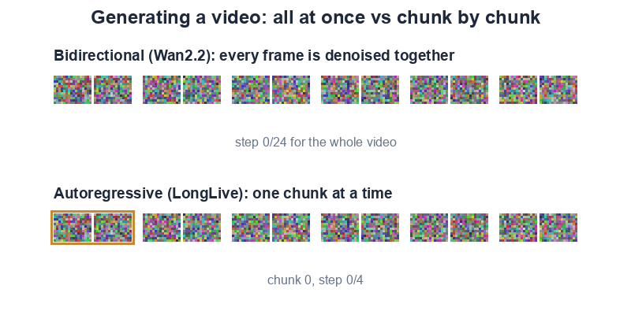
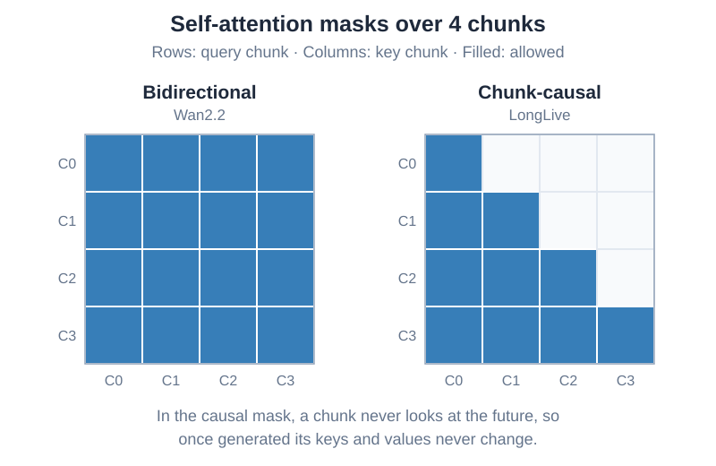
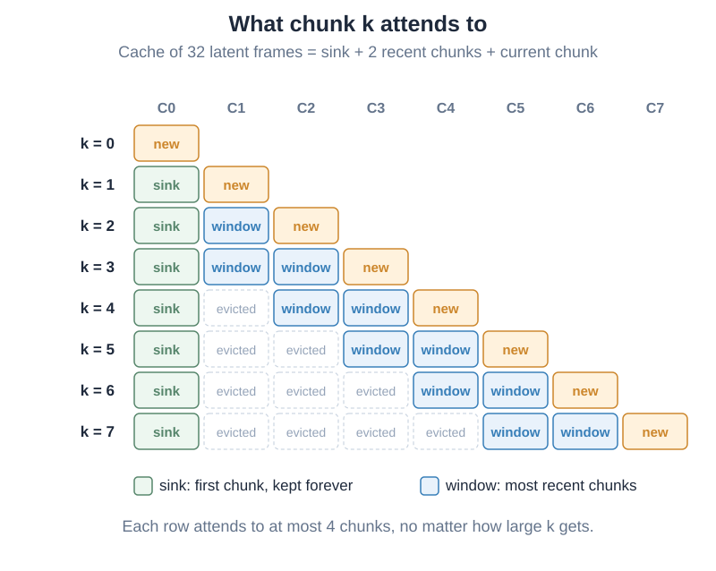
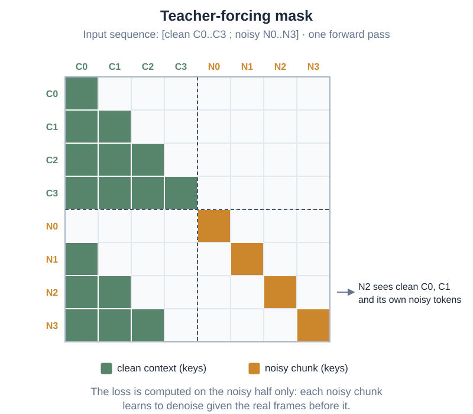
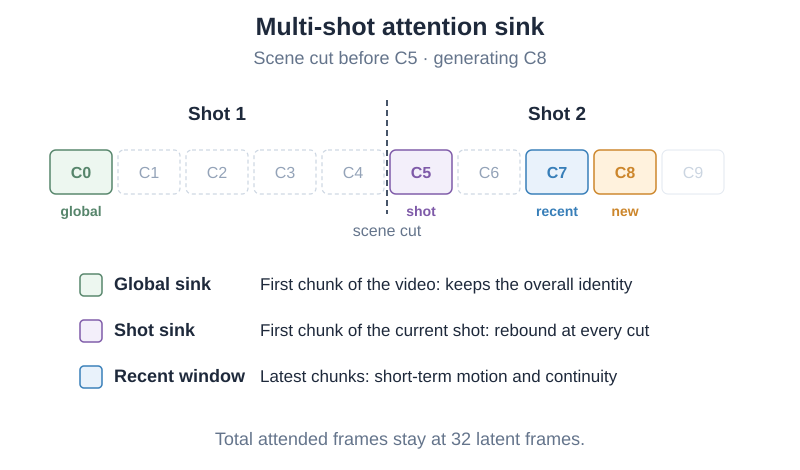

We followed Wan2.2 from a text prompt to a 121-frame video in the [previous post](). The whole video was one sample: we started from one noise tensor, and every sampling step updated all the frames together. That works well for a five-second clip. But what if we want a one-minute video? Or a video we can **watch while it is being generated**, and steer by changing the prompt halfway through?

Generating everything at once makes all of these hard. In this post, we will look at a different approach: **autoregressive (AR) video generation**, where the model generates a video **chunk by chunk**, each chunk conditioned on the ones before it. It is the same idea that large language models (LLMs) use to write one token after another, combined with the flow matching we already know.

As a case study, we will use **[LongLive 2.0](https://nvlabs.github.io/LongLive/LongLive2/)** from NVIDIA. It turns **Wan2.2-TI2V-5B** into a **causal, streaming** video generator that can produce minute-long videos with prompt changes and scene cuts. The paper covers a lot: NVFP4 quantization, sequence parallelism, custom kernels. For now, we will leave that infrastructure aside and focus on **how the algorithm works**: how a bidirectional model becomes causal, how it is trained, and how inference runs one chunk at a time.

Since LongLive 2.0 is built on Wan2.2, please check out the [Wan2.2 post]() if you are new to the model. Patch embedding, AdaLN, 3D RoPE, and cross-attention all work the same way here. What changes is **which tokens can attend to which**, and **in what order we generate them**.

## Foundations

### Why Not Generate Everything at Once?

Recall the shapes from the Wan2.2 post: a 121-frame video at $704\times1280$ becomes a latent of shape `[48, 31, 44, 80]` and $N=27{,}280$ video tokens. Self-attention compares every token with every other token, so its cost grows with $N^2$. A one-minute video at the same resolution has about 12 times as many tokens, so attention costs more than 100 times as much per step. Long before that, the GPU memory usage blows up.

There are two other problems, even if we had unlimited compute:

1. **Latency.** Every frame is noisy until the very last step. We cannot show the first second of the video until the last second is also finished.
2. **Interactivity.** The prompt is fixed before sampling starts. There is no natural point at which a user can say "now make the corgi jump into a lake."

Both problems come from the same design choice: Wan2.2 models the **whole video as one sample**, and its self-attention is **bidirectional**: the first frame can look at the last frame, and vice versa.

### Generating Chunk by Chunk

LLMs solve a similar problem by factorizing the distribution of a sentence into a product of next-token distributions. We can do the same for video. Split the video latent $z$ into $K$ chunks, $z=(z^1,z^2,\dots,z^K)$, each holding a few latent frames. Then

$$
p(z\mid y)=\prod_{k=1}^{K}p\left(z^k\mid z^{\lt k},y\right),
$$

where $z^{\lt k}$ denotes all chunks before $k$ and $y$ is the prompt. We generate $z^1$, then $z^2$ given $z^1$, then $z^3$ given $z^1,z^2$, and so on.

Unlike a token, each chunk is a continuous latent with thousands of values, so we cannot pick it from a softmax. Instead, **we learn each of these conditional distributions with flow matching**. To generate chunk $k$, we start from noise and follow a learned velocity field that also sees the previous chunks:

$$
\frac{dx^k_t}{dt}=v_\theta\left(x^k_t,\,t,\,z^{\lt k},\,y\right).
$$

Here, $x^k_t$ is chunk $k$ at flow time $t$. Following Wan's convention, $t=1$ is pure noise and $t=0$ is the clean chunk $z^k$, so generation runs from $t=1$ down to $t=0$.

So there are **two loops**. The outer loop walks forward in video time, one chunk at a time; this is the autoregressive part. The inner loop walks along the flow time $t$, from noise to a clean chunk; this is the flow matching part we already know. The animation below shows the difference.



*Wan2.2 denoises the whole video together, so nothing is ready until the end. An AR model finishes chunk 0 first, so we can start playing it while later chunks are still being generated.*

Why chunks and not single frames? A chunk of several latent frames gives the model enough temporal context to produce smooth motion within it, and each DiT call processes more tokens at once, which keeps the GPU busy. LongLive 2.0 uses chunks of **8 latent frames**, which is about 32 video frames, or 1.3 seconds at 24 fps.

### Causal Attention

How does the DiT "see" the previous chunks? Through self-attention, but with a mask. For AR generation, we want chunk $k$ to depend only on chunks $1,\dots,k$, never on the future. So we use a **chunk-causal mask**: a token in chunk $k$ may attend to every token in its own chunk and in earlier chunks.

Writing $c(i)$ for the chunk that token $i$ belongs to,

$$
M_{ij}=
\begin{cases}
1, & c(j)\le c(i),\\
0, & \text{otherwise}.
\end{cases}
$$

Within a chunk, attention is still bidirectional, so frames inside a chunk can coordinate with each other. Across chunks, information only flows forward in time.



The rest of the DiT does not change. Cross-attention, AdaLN, and the FFN all act on each token independently of other video tokens, so they need no mask. **Self-attention is the only place where tokens from different frames interact**, and that is the only place we need to make causal.

### KV Cache

The causal mask has a useful consequence. Since chunk $k$ never looks at later chunks, its keys and values in every attention layer stay **fixed** once it is finished. We can compute them once and store them. This is the **KV cache**, exactly as in LLMs.

When we generate chunk $k+1$, the DiT only processes the new chunk's tokens. Each self-attention layer computes queries, keys, and values for those new tokens, then attends over the **cached keys and values of earlier chunks plus its own**:

$$
\operatorname{Attention}\left(Q_{k+1},\,[K_{\mathrm{cache}};K_{k+1}],\,[V_{\mathrm{cache}};V_{k+1}]\right).
$$

In our example, each latent frame has $22\times40=880$ tokens after Wan's $2\times2$ patching, so a chunk of 8 latent frames has $7{,}040$ tokens, compared with $27{,}280$ for the whole Wan2.2 video. The queries never grow; only the keys and values do.

Notice that at inference time we **do not need a mask at all**. Causality comes from what is in the cache: future chunks have not been generated yet, so they simply are not there to attend to. The mask only matters during training, when the whole video is processed at once.

There is one subtle point. To generate chunk $k$, we run the DiT once per sampling step, each time at a different noise level. **Which version of its keys and values should we cache?** Even the last step's are computed from a slightly noisy input, while later chunks should see a clean history.

LongLive's answer is simple: after the chunk is finished, run the DiT **one more time** on the clean chunk at $t=0$, keep the keys and values it writes to the cache, and discard its output. During denoising, the chunk also writes its noisy keys and values into the same slot, because its tokens need them to attend to each other, but each write replaces the previous one, so only the final clean write remains. With 4 sampling steps, one chunk costs $4+1=5$ DiT calls. The clean cache matches what the model saw during training, as we will see in [Teacher Forcing](#teacher-forcing).

### Positions Across Chunks

There is one more thing the model needs to know: **where in the video** the new chunk sits. In Wan2.2, 3D RoPE assigned frame positions $0,1,\dots,30$ to the whole video at once. Now, each DiT call only sees 8 latent frames. If we numbered them $0,\dots,7$ every time, the model would think every chunk is the start of the video.

So chunk $k$ uses frame positions $8k,\,8k+1,\dots,8k+7$, continuing from where the previous chunk ended. Only the temporal axis changes; the row and column positions are the same as before.

There is a neat detail here: the keys are stored in the cache **after** RoPE has been applied. Each cached key already carries its own frame position, so when a new chunk's queries attend to old keys, RoPE's relative-position property works as usual, without recomputing anything for the old chunks.

### Sliding Window and Attention Sink

The KV cache removes repeated computation, but the cache itself still grows with video length, and each new chunk attends over all of it.

The natural fix is a **sliding window**: only keep the most recent few chunks. Motion and short-term continuity mostly depend on what just happened, so this works surprisingly well, but it has a failure mode. Once the first chunk leaves the window, the model no longer sees what the main character originally looked like, and small changes start to accumulate. After a minute, the corgi might have become a different dog.

LongLive borrows a trick from [StreamingLLM](https://arxiv.org/abs/2309.17453) called an **attention sink**: keep the **first chunk** in the cache permanently, in addition to the sliding window. The name comes from LLMs, where the first few tokens tend to absorb a large share of the attention weights, and removing them hurts the model badly. In video, the first chunk plays a similar role: it acts as an anchor for identity and style, while the window provides recent motion.



LongLive 2.0 uses a cache of 32 latent frames: 8 for the sink, 16 for the two most recent chunks, and 8 for the chunk being generated. While generating chunk $k$, the new queries attend to

$$
\mathcal K_{\mathrm{eff}}=\underbrace{\mathrm{KV}_{\mathrm{sink}}}_{\text{first chunk}}\;\cup\;\underbrace{\mathrm{KV}_{\text{recent}}}_{\text{last 2 chunks}}\;\cup\;\underbrace{\mathrm{KV}_{k}}_{\text{current chunk}}.
$$

When a new chunk arrives and the cache is full, the oldest chunk after the sink is evicted. So each self-attention call compares $7{,}040$ queries with at most $32\times880=28{,}160$ keys, no matter how long the video gets. The cost per chunk is **constant**.

## Training a Causal Model

Wan2.2 was trained with bidirectional attention. If we simply switch on the causal mask at inference time, the model breaks: its weights expect to see future frames. We need to fine-tune it with the causal mask. This also explains several choices in the inference loop.

### Teacher Forcing

How do we train $v_\theta(x^k_t,t,z^{\lt k},y)$? The most direct way follows the factorization: take a real video, encode it into chunks, and for each chunk $k$, train the model to denoise a noisy version of $z^k$ given the **real, clean** chunks $z^{\lt k}$. This is **teacher forcing**, the same name used for training LLMs on ground-truth prefixes.

Running one forward pass per chunk would be slow. LongLive instead puts **two copies** of the video in one sequence: the clean chunks $z^1,\dots,z^K$, then noisy chunks $x^1_{t_1},\dots,x^K_{t_K}$, where each chunk gets its own random timestep. Then it uses a mask in which

- clean chunks attend causally to clean chunks;
- noisy chunk $k$ attends to the **clean** chunks before it and to **its own** noisy tokens only.



Why do the clean chunks need to go through the network at all? Because each attention layer needs the clean chunks' keys and values **at that layer**, and those depend on everything the earlier layers computed. Running the clean half through the DiT with a causal mask produces exactly the keys and values that the KV cache will hold at inference time, where each chunk was also processed causally at $t=0$.

The clean and noisy copies of a chunk also receive the **same 3D RoPE positions**, so the model knows that $x^k$ and $z^k$ describe the same moment in the video.

With this mask, a single forward pass supervises all $K$ chunks at once. Each noisy chunk is trained with the ordinary flow matching loss, using Wan's convention $x_t=(1-t)z+t\epsilon$:

$$
\mathcal L_{\mathrm{TF}}(\theta)=
\mathbb E\left[\sum_{k=1}^{K}
\left\|v_\theta\left(x^k_{t_k},\,t_k,\,z^{\lt k},\,y\right)-\left(\epsilon^k-z^k\right)\right\|^2\right].
$$

Now we can see why inference recomputes the cache at $t=0$. **During training, the context was always clean.** During inference, the cache plays the role of that context, so it should hold clean keys and values too.

An alternative is [diffusion forcing](https://arxiv.org/abs/2407.01392), which trains every chunk at an independent noise level and lets noisy chunks serve as context. LongLive 2.0 deliberately uses clean-context teacher forcing, because at inference time the context is always clean, and training should match that.

### Exposure Bias and Error Recycling

Teacher forcing has a well-known weakness. During training, the context is always a **real** video. During inference, the context is the model's **own** output, which contains small mistakes. The model never learned what to do with imperfect history, so errors can compound from chunk to chunk: a slight blur in chunk 3 becomes a stronger blur in chunk 4, and so on. This mismatch is called **exposure bias**, and for long videos it shows up as gradual **drift**.

LongLive 2.0 uses **error recycling** from [Stable Video Infinity](https://arxiv.org/abs/2510.09212). During training, the model's prediction errors, the differences between its predicted clean chunks and the real ones, are collected into a buffer, grouped by timestep. Later, those errors are randomly added to the clean context before it is fed to the model. The model therefore sees realistic, slightly wrong histories and learns to correct them rather than amplify them. The target is still the real video, so the model is pushed back toward clean results.

### Few-Step Distillation

After causal training, the model still needs many sampling steps per chunk, often with CFG, which doubles the DiT calls. That is far too slow for streaming. LongLive 2.0 therefore distills the model into a **few-step** generator using [distribution matching distillation (DMD)](https://arxiv.org/abs/2311.18828).

We will skip the details of DMD, but the idea is worth knowing. It uses three copies of the network:

- a **student** (the generator we want), which produces each chunk in 4 steps;
- a frozen **teacher**, initialized from Wan2.2 with the causal mask applied and run with CFG scale 3;
- a **critic**, trained with flow matching on the student's outputs, so its predictions describe what the student currently generates.

We take a student output $z_\theta$, add noise to get $x_t$, and ask both the teacher and the critic to predict the clean video. The critic tells us where the student's samples **currently are**; the teacher tells us where they **should be**. We update the student to reduce their disagreement:

$$
\nabla_\theta\mathcal L_{\mathrm{DMD}}
\approx\mathbb E_{t,\epsilon}\left[
\left(\hat z_{\mathrm{critic}}(x_t,t)-\hat z_{\mathrm{teacher}}(x_t,t)\right)
\frac{\partial z_\theta}{\partial\theta}\right].
$$

Here, $\hat z_{\mathrm{critic}}-\hat z_{\mathrm{teacher}}$ points from where the samples should be toward where they are, so a gradient descent step moves the student's output the other way, toward the teacher. We never need the teacher's full sampling trajectory, only its prediction at one noise level.

Two details matter for us. First, the student generates its training videos the same way it will at inference, **chunk by chunk with its own KV cache**, an idea from [Self Forcing](https://arxiv.org/abs/2506.08009). So the student is trained on its own imperfect histories, which further reduces exposure bias. Second, the teacher uses CFG, so the guidance is **baked into the student**: at inference time, LongLive 2.0 runs with guidance scale 1, meaning **one DiT call per step instead of two**.

LongLive 2.0 only trains small LoRA adapters during this stage, keeping the backbone fixed, which the paper reports is more stable.

## LongLive 2.0 Inference

We now have all the pieces, so let's see how they fit together when LongLive 2.0 generates a video. The official code is a bit complicated, so I plan to have a separate post that walks through it. Here, we will stay at the level of the generation loop.

### Settings

The default [inference config](https://github.com/NVlabs/LongLive/blob/main/LongLive2.0/configs/inference.yaml) generates 128 latent frames at the same $704\times1280$ resolution we used for Wan2.2. The VAE compresses time by 4 and keeps the first frame separately, so that is $1+4\cdot127=509$ RGB frames, or about 21 seconds at 24 fps.

| Setting | Value |
| --- | --- |
| Base model | Wan2.2-TI2V-5B, causal |
| Chunk size | 8 latent frames, $7{,}040$ tokens |
| Number of chunks | 16 |
| KV cache | 32 latent frames, including an 8-frame sink |
| Sampling steps per chunk | 4 |
| Guidance scale | 1.0 (CFG baked in by distillation) |

### Generation Loop

Here is one chunk's journey through the pipeline.


As pseudo code, the whole generation becomes:

```python
noise = randn(1, 128, 48, 44, 80)              # 128 latent frames
cache = empty_kv_cache(window=32, sink=8)      # Per-layer K, V buffers

for k in range(16):                            # Outer loop: video time
    text = text_encoder(prompts[k])            # Each chunk can have its own prompt
    x = noise[:, 8 * k : 8 * k + 8]            # Noise for chunk k: 8 latent frames

    for t in solver.timesteps:                 # Inner loop: flow time, 4 steps
        v = dit(x, t, text, cache, start_frame=8 * k)
        x = solver.step(v, t, x)

    dit(x, 0, text, cache, start_frame=8 * k)  # Write clean K, V for chunk k
    show(vae.decode_chunk(x))                  # About 32 RGB frames
```

Compare it with the Wan2.2 loop. The inner loop is the same: predict a velocity, take a solver step. What is new is the outer loop, the cache passed into every DiT call, and the extra $t=0$ call at the end. A few details are worth pointing out:

- Each chunk runs its **own flow** from $t=1$ to $t=0$. There is no noise schedule shared across chunks.
- `start_frame=8 * k` gives the chunk its [position in the video](#positions-across-chunks), and tells the cache where the chunk's keys and values belong.
- Each chunk can have **its own prompt**, which is what makes interactive generation possible, as we will see next.

The last line is also worth a note. The Wan2.2 VAE is causal in time, so it can decode the video **chunk by chunk**. LongLive 2.0 decodes each chunk as soon as it is finished, while the DiT moves on to the next one, so the first frames can appear on screen after only the first chunk.

### Prompt Switching and Scene Cuts

Since each chunk has its own prompt, changing the prompt is easy: give chunk $k$ a new prompt. Cross-attention for that chunk uses the new text, while self-attention still reads the history from the cache. The new content therefore **continues from the old scene** rather than starting over: the corgi keeps its look and position, but starts doing what the new prompt says.

Sometimes we want the opposite: a **hard scene cut**, like an edit in a film. LongLive 2.0 treats a prompt starting with `"The scene transitions. "` as a new shot. It then keeps the first chunk of the new shot in the cache as a **shot sink**, alongside the original **global sink**. The global sink keeps the identity of the whole video, such as characters and style, while the shot sink anchors the current shot, such as its location and camera setup. The cache still holds 32 latent frames, so the recent window gets smaller.



It also shifts the **temporal RoPE positions** by 8 frames at each new shot. From the model's point of view, there is a jump in time between shots, so the new shot does not need to continue the previous motion.

## Putting It Together

We can now follow how LongLive 2.0 turns Wan2.2 into a streaming generator. The causal mask makes each chunk depend only on the past. That makes its keys and values fixed, so we can cache them, with positions that continue from chunk to chunk. A sliding window with an attention sink keeps the cache, and the cost per chunk, constant. Teacher forcing trains all chunks in one forward pass with a clean context, which is why inference re-runs each finished chunk at $t=0$. Error recycling and DMD distillation expose the model to its own imperfect history, and DMD also reduces each chunk to a few steps with CFG built in.

Looking back, autoregressive generation is a trade. A bidirectional model sees the whole clip at once, so every frame can adjust to every other frame, but the length is fixed and nothing can be shown until the end. A causal model gives up that global view: once a chunk is generated, it is final. In return, the video can stream, grow without a fixed length, and follow new prompts while it plays. Most of the ideas in this post are the price of that trade: the cache and the sink keep the past cheap to remember, and teacher forcing, error recycling, and DMD teach the model to build on a past it cannot change.
