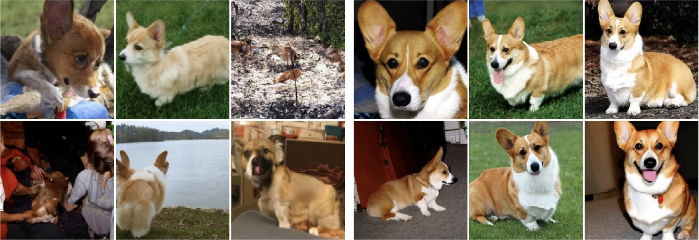

In the previous posts, we discussed how [flow matching]() and [diffusion models]() transform noise into data. But we usually want something more specific, such as "a cat with orange and white fur" or "a corgi running through the snow."

**How do we make the model follow such prompt?**

This brings us to **classifier-free guidance (CFG)**: compare the model's predictions with and without a condition, then amplify their difference. We will start with flow matching, then connect the result to diffusion models.

## Vanilla Guidance

The first idea is straightforward: simply give the condition $y$ to the network. For a paired example $(z,y)$, $z$ is an image and $y$ is its caption or class label.

To generate from $p_{\mathrm{data}}(z\mid y)$, we hold $y$ fixed and follow the network's predicted velocity:

$$
\frac{dX_t}{dt}=v_\theta(X_t,t,y),
\qquad X_0\sim\mathcal N(0,I_d).
$$

Training uses the same linear interpolation and target velocity as before:

$$
X_t=(1-t)\epsilon+tz,
\qquad
\frac{dX_t}{dt}=z-\epsilon.
$$

We train with

$$
\boxed{
\mathcal L_{\mathrm{CFM}}^{\mathrm{guided}}(\theta)=
\mathbb E_{t,(z,y),\epsilon}
\left[
\left\|v_\theta(X_t,t,y)-(z-\epsilon)\right\|^2
\right].
}
$$

Here, $(z,y)\sim p_{\mathrm{data}}$, $t\sim\mathcal U(0,1)$, and $\epsilon\sim\mathcal N(0,I_d)$ are drawn independently. We therefore get a guided flow matching objective. In theory, this vanilla guidance should give us good enough generation results, but in practice people noticed the generation quality is often lower than what we expect. Or the generated images may look realistic, but not follow the prompt closely.

This can be attributed to multiple reasons: the model might underfit, and prompt labels can be inaccurate etc. Therefore, we want a way to **strengthen the condition during sampling**, for example artifically reinforce the prompt.



*"Corgi dog" samples: vanilla conditioning on the left, CFG with $w=4$ on the right. Figures taken from [Ho and Salimans](https://arxiv.org/abs/2207.12598).*

## Classifier Guidance

To strengthen the condition, we first need to identify its contribution. Recall the unconditional and conditional scores:

$$
s_t(x)=\nabla_x\log p_t(x),
\qquad
s_t(x\mid y)=\nabla_x\log p_t(x\mid y).
$$

By Bayes' rule,

$$
p_t(x\mid y)=\frac{p_t(y\mid x)p_t(x)}{p(y)}.
$$

Taking the log and differentiating with respect to $x$, the term $\log p(y)$ disappears:

$$
\boxed{
s_t(x\mid y)=s_t(x)+\nabla_x\log p_t(y\mid x).
}
$$

The extra term tells us how to change the noisy sample $x$ to make $y$ more likely. For $y=\text{“corgi”}$, it points toward increasing confidence in the corgi label. This is where the **classifier** comes in.

### From Scores to Velocities

For the Gaussian path $X_t=\alpha_tZ+\beta_t\epsilon$, in previous post we proved scores and velocities can be connected through

$$
u_t(x)=A_t x+B_t s_t(x),
$$

where

$$
A_t=\frac{\dot\alpha_t}{\alpha_t},
\qquad
B_t=\frac{\dot\alpha_t}{\alpha_t}\beta_t^2-\beta_t\dot\beta_t.
$$

Using the same schedules for conditional generation, we get

$$
\begin{aligned}
u_t(x\mid y)
&=A_t x+B_t\left[s_t(x)+\nabla_x\log p_t(y\mid x)\right]\\
&=u_t(x)+B_t\nabla_x\log p_t(y\mid x).
\end{aligned}
$$

We have now separated the velocity into an unconditional part and a contribution from the condition. To strengthen the latter, we multiply it by a **guidance scale** $w$:

$$
\boxed{
\widetilde u_t(x\mid y)
=u_t(x)+wB_t\nabla_x\log p_t(y\mid x).
}
$$

With $w=1$, we recover the ordinary conditional field. With $w>1$, we push more strongly in the direction favored by the condition.

**But how to obtain $\nabla_x\log p_t(y\mid x)$?**

We train a classifier $q_\phi(y\mid x,t)$ on noisy images and their class labels. During sampling, we differentiate its log probability with respect to $x$ to estimate the required gradient. This steers the sample toward higher confidence in the requested class, hence called **classifier guidance**, introduced by [Dhariwal and Nichol](https://arxiv.org/abs/2105.05233).

### Why Avoid the Classifier?

The extra classifier adds training work and requires backpropagation at every sampling step. For text prompts, predicting the probability of a full description given a noisy image is also much harder than classifying a fixed set of labels.

Instead, can we obtain the same direction from the generative model itself? This leads to the classifier-free guidance that we will discuss next.

## Classifier-Free Guidance

In the previous section, we derived $u_t(x\mid y)=u_t(x)+B_t\nabla_x\log p_t(y\mid x)$. Rearranging this equation isolates the classifier's contribution:

$$
B_t\nabla_x\log p_t(y\mid x)
=u_t(x\mid y)-u_t(x).
$$

Substitute this difference into classifier guidance:

$$
\begin{aligned}
\widetilde u_t(x\mid y)
&=u_t(x)+w\left[u_t(x\mid y)-u_t(x)\right]\\
&=(1-w)u_t(x)+w\,u_t(x\mid y).
\end{aligned}
$$

**But don't we still need two models to make those two predictions?**

The answer is **No**. Since both predictions can come from the **same network**, we can use a special null condition $\varnothing$ for the unconditional one, that's why it's called **classifier-free guidance**:

$$
v_\theta(x,t,y)\approx u_t(x\mid y),
\qquad
v_\theta(x,t,\varnothing)\approx u_t(x).
$$

During sampling, combine them as

$$
\boxed{
\widetilde v_\theta(x,t,y)
=v_\theta(x,t,\varnothing)
+w\left[v_\theta(x,t,y)-v_\theta(x,t,\varnothing)\right].
}
$$

Both evaluations use the **same sample and time**, and we combine them before taking a sampling step.

### What Does the Guidance Scale Do?

| Guidance scale | Result |
| --- | --- |
| $w=0$ | Use only the unconditional prediction. |
| $w=1$ | Use the ordinary conditional prediction. |
| $w>1$ | Extrapolate beyond the conditional prediction in the direction of its difference from the unconditional one. |

Stronger guidance often improves adherence at the cost of diversity; too much can also hurt image quality. At $w>1$, we deliberately change the field, so the generated distribution need not equal $p_{\mathrm{data}}(\cdot\mid y)$. Its usefulness is an empirical result.

## Training with CFG

To teach the network both tasks, we **randomly discard conditions during training**, keeping the data and regression targets unchanged.

With dropout probability $0\lt\eta\lt1$, define

$$
\widetilde Y=
\begin{cases}
\varnothing, & \text{with probability }\eta,\\
Y, & \text{with probability }1-\eta.
\end{cases}
$$

Drop conditions independently of the data, noise, and time. Using $X_t=\alpha_tZ+\beta_t\epsilon$, the loss becomes

$$
\boxed{
\mathcal L_{\mathrm{CFM}}^{\mathrm{CFG}}(\theta)
=\mathbb E_{t,(Z,Y),\epsilon,\widetilde Y}
\left[
\left\|
v_\theta(X_t,t,\widetilde Y)
-(\dot\alpha_t Z+\dot\beta_t\epsilon)
\right\|^2
\right].
}
$$

For the linear path, the target is simply $Z-\epsilon$.

### What Does the Null Label $\varnothing$ Mean?

The null label means **no class or prompt was supplied**. Text models can use a learned null embedding or an encoded empty prompt. Use the same representation during training and sampling.

**Why does hiding the label teach an unconditional model?**

Imagine a dataset of cats and dogs. Randomly hiding labels leaves the same mix of images, so the model learns to predict velocity without being told the class, just as in unconditional training. The examples whose labels we keep teach it the conditional task.

The dropout probability $\eta$ controls training; the guidance scale $w$ is chosen during sampling. **The guided combination is not part of the training loss.**

## PyTorch Example

Here is a simple training example: randomly drop some labels, then train the model to predict velocity as before.

### Training

```python
import torch

null_id = num_classes
drop_prob = 0.1  # Example choice, not a universal optimum.

model.train()
z, y = sample_data(batch_size)
noise = torch.randn_like(z)
t = torch.rand(z.shape[0], 1, device=z.device, dtype=z.dtype)

xt = (1 - t) * noise + t * z
target_velocity = z - noise

drop = torch.rand(y.shape, device=y.device) < drop_prob
y_input = torch.where(drop, torch.full_like(y, null_id), y)

predicted_velocity = model(xt, t, y_input)
loss = (predicted_velocity - target_velocity).square().sum(-1).mean()

optimizer.zero_grad()
loss.backward()
optimizer.step()
```

### Sampling

At each Euler step, evaluate the model with and without the requested label, combine the velocities, and update the sample:

```python
@torch.no_grad()
def sample_cfg(model, x0, y, null_id, steps=100, guidance_scale=4.0):
    # x0: Gaussian noise [batch, d]; y: requested labels [batch].
    model.eval()
    x = x0.clone()
    y_null = torch.full_like(y, null_id)
    h = 1.0 / steps

    for k in range(steps):
        t = x.new_full((x.shape[0], 1), k * h)
        v_uncond = model(x, t, y_null)
        v_cond = model(x, t, y)
        velocity = v_uncond + guidance_scale * (v_cond - v_uncond)
        x = x + h * velocity

    return x


# y, device, dtype, and d match the trained model's inputs.
x0 = torch.randn(y.shape[0], d, device=device, dtype=dtype)
samples = sample_cfg(model, x0, y, null_id, guidance_scale=4.0)
```

At each step, CFG combines predictions with and without the condition. The step count and guidance scale can be adjusted for the model.

## What About Diffusion Models?

We derived CFG using velocities, but the same construction works directly with scores:

$$
\widetilde s_\theta(x,t,y)
=(1-w)s_\theta(x,t,\varnothing)+w\,s_\theta(x,t,y).
$$

For a noise predictor, recall that $s_\theta=-\epsilon_\theta/\beta_t$. Both predictions use the same $\beta_t$, so we can combine the noise estimates instead:

$$
\boxed{
\widetilde\epsilon_\theta(x,t,y)
=(1-w)\epsilon_\theta(x,t,\varnothing)
+w\,\epsilon_\theta(x,t,y).
}
$$

Training still uses random condition dropout, with the sampled noise as the regression target. During sampling, substitute the combined prediction into the diffusion sampler.

## Summary

CFG comes down to two steps: randomly drop conditions during training, then amplify the difference between conditional and unconditional predictions during sampling. It saves us from training two models, and provides the flexibility of adjusting how strongly the prompt influences the generation.

