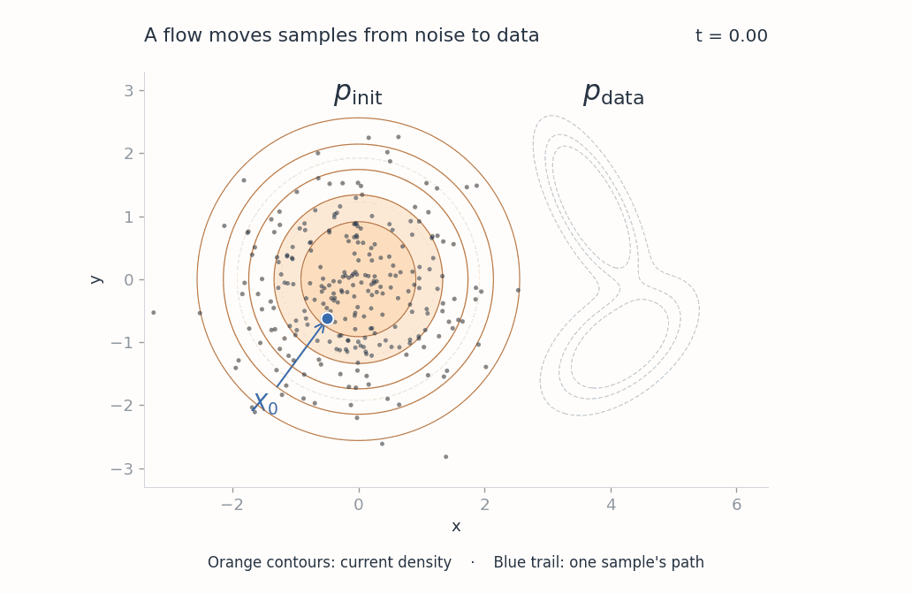
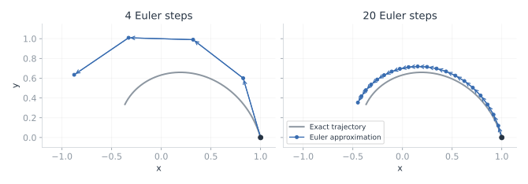
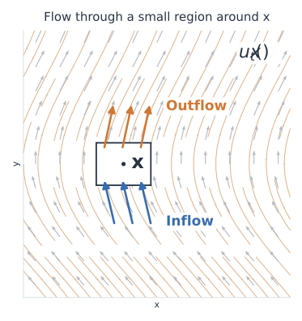

Creating noise from data is easy; creating data from noise is generative modeling. This quote from [Song et al.](https://arxiv.org/abs/2011.13456) captures the basic idea of generative modeling: we are trying to find a way from noise to data.

In this post, I will go through **flow matching**, a method for image and video generation. There are already many articles explaining the theory of flow matching, but here I want to start from first principles and work through the reasoning behind it—why we take this approach, and how it actually works.

## Background

Let's begin with a simple question: **why do we start from noise?**

Recall that our goal is to train a model on a dataset and have it generate new samples from the same data distribution, instead of just repeating the examples it has seen. But the problem is, we don't know the analytical form of that distribution. If we want to write a program to sample from it, how would we do that?

One way to approach this is to start with a distribution we already know how to sample from, then learn a transformation connecting it to the data distribution. Let's call them $p_{\mathrm{init}}$ and $p_{\mathrm{data}}$. Each time we want to generate something, we sample from $p_{\mathrm{init}}$ and apply the learned transformation. If we learn this transformation well, the resulting samples should approximately follow $p_{\mathrm{data}}$.

A common choice for the initial distribution is a standard Gaussian:

$$
p_{\mathrm{init}} = \mathcal{N}(0, I_d).
$$

This is the distribution we will use throughout the post.

Note that it isn't necessary to start from a Gaussian. Other initial distributions are possible, provided they are easy to sample from and suitable for the transformation we want to learn. The reason for using a Gaussian here is that it has convenient mathematical properties, which will make the later derivations simpler.

### A Brief History

You might wonder: **wouldn't learning a direct mapping from noise to data do the job?**

Actually, this is the idea behind [VAEs](https://arxiv.org/abs/1312.6114) and [GANs](https://arxiv.org/abs/1406.2661). They map samples from a latent distribution into data, although their training methods are different.

But learning the whole transformation at once can be difficult. Can we make the learning problem easier by breaking it into smaller steps? If going from noise to data in one step is hard, why not use 10 steps, 100 steps, or more? At each step, we ask the model how the current sample should change, and gradually move it toward the data distribution. This takes more computation during generation, but it gives us a different way to learn the transformation.

Flow matching builds on earlier work on **continuous normalizing flows**, which describe this transformation as continuous motion. In particular, flow matching uses a neural network to learn the **vector field** without simulating the whole motion during training. We will go through that training method below, following the [original flow matching paper](https://arxiv.org/abs/2210.02747).

## What Is Flow?

A flow describes how something moves from one place to another, like water flowing through a river. Imagine putting many leaves on the water. Each leaf moves with the water flow, and together their positions form a distribution. As the leaves spread out or gather together, that distribution changes, even though no leaves are added or removed.

For generative modeling, we can think of each leaf as a sample $x \in \mathbb{R}^d$. If we are generating images, one point represents an entire image. We want a flow that moves samples from $p_{\mathrm{init}}$ at time $0$ to $p_{\mathrm{data}}$ at time $1$. Then starting from a new noise sample and following its motion gives us a way to generate data.



*Toy example: the orange contours show the changing density as samples move from $p_{\mathrm{init}}$ to $p_{\mathrm{data}}$. The blue trail follows one sample from $X_0$ to $X_1$, and the dashed contours mark the initial and target distributions.*

Flow matching will help us learn the rule that drives this motion. To understand how, let's first look at how we describe motion mathematically and follow it from a starting point.

### Vector Field & ODE

Here comes another important question: **How do we know where a sample should go, regardless of where it starts?**

For a leaf in a river, its motion is determined by the water velocity at its current location. We describe a rule like this using a **vector field**:

$$
u_t : \mathbb{R}^d \rightarrow \mathbb{R}^d.
$$

Here, $u_t(x)$ gives the velocity at location $x$ and time $t$: both the direction and the rate of change. You may also see this called a velocity field. We will use **vector field** for the function and **velocity** for the vector it returns at a particular location and time.

If the sample is currently at $X_t$, its velocity should be $u_t(X_t)$. We express this relationship as an ordinary differential equation (**ODE**):

$$
\frac{dX_t}{dt} = u_t(X_t),
\qquad X_0 \sim p_{\mathrm{init}},
\qquad t \in [0,1].
$$

The left side is the rate of change of the sample, and the right side gives the velocity at its current position. The ODE says that these must agree throughout the motion, starting from a noise sample $X_0$.

This way of describing motion has been used in physics for centuries. Differential equations grew out of [seventeenth-century work on geometry and mechanics](https://ocw.mit.edu/courses/18-034-honors-differential-equations-spring-2009/32b7e82f0a87e792d6750e1ac7a92e71_MIT18_034s09_lec06.pdf#page=5), including Newton's work on motion. Here, we borrow that framework to describe changes in a sample's pixel or latent values. The time $t$ measures progress from noise to data, rather than the actual time spent computing.

### Solving the ODE

The vector field tells us how fast a sample should move at each location. But to generate something, we need to know where that motion takes it. We find this by solving the ODE.

So, what does **solving the ODE mean?** Given a vector field and a starting sample, it means finding the sample's position at later times. The solution is a trajectory $X_t$ that starts at $X_0$ and follows the vector field throughout the motion.

For a simple one-dimensional example, suppose the velocity is always $2$. The solution is $X_t=X_0+2t$: it starts at $X_0$, and its derivative is $2$ at every time. At $t=1$, the sample has reached $X_0+2$.

Solving the ODE for each possible starting point defines the **flow map** $\phi_t$. It tells us where an initial position ends up at time $t$:

$$
X_t = \phi_t(X_0),
\qquad \phi_0(x) = x.
$$

This also explains why **the flow is deterministic**. Assuming the ODE has a unique solution, fixing the field and $X_0$ fixes the whole trajectory. The randomness comes from sampling $X_0$. Once the motion starts, the current position and time determine how the sample moves next.

### Numerical Simulation

For a constant velocity, we could write down the solution directly. But for the more complicated fields we want to learn, we usually cannot find a simple formula for the trajectory. So how do we follow it in practice?

We approximate the motion numerically. One simple method is to evaluate the velocity, take a small step in that direction, and repeat from the new position. This is **Euler's method**. Divide the time interval into $N$ steps, set $h=1/N$ and $t_k=kh$, and update

$$
x_{k+1} = x_k + h\,u_{t_k}(x_k),
\qquad k = 0,\ldots,N-1.
$$

Here, $x_k$ approximates the sample at time $t_k$, and $h\,u_{t_k}(x_k)$ is the change we make during that step. Starting from a noise sample $x_0$, we repeat the update until $t_N=1$ and take $x_N$ as the generated sample.



*Euler's method: the gray line represents the exact trajectory, and each segment follows the velocity at its starting point. With smaller steps, the approximation follows the exact trajectory more closely.*

Smaller steps can make the approximation more accurate, at the cost of more vector field evaluations. There are more accurate ODE solvers too, but the purpose is the same: follow the vector field from the initial sample to the final one.

People usually use a neural network $v_\theta(x,t)$ to predict the velocity at position $x$ and time $t$. The solver follows these predictions to generate a sample; we will discuss the training method next.

## Flow Matching

We now know how a vector field defines the motion and how to follow it during generation. The remaining task is to learn the field from data.

Flow matching does this by constructing target velocities for the network $v_\theta(x,t)$ to learn. To define those targets, we first need to decide how we want the distribution to change between noise and data.

### Probability Path

A **probability path** is a family of distributions $\{p_t\}_{t \in [0,1]}$. You can think of it as the evolution of the whole distribution over time. We want it to start from noise and end at the data distribution:

$$
p_0 = p_{\mathrm{init}},
\qquad p_1 = p_{\mathrm{data}}.
$$

This is slightly different from the trajectory of one sample. A trajectory describes where that sample goes, while a probability path describes how the distribution of all samples changes. There can be different ways to move the samples and still get the same distributions, so a probability path does not generally determine a unique vector field.

### Naive Flow Matching Loss

Let's use $u_t(x)$ to denote a target vector field that generates our chosen probability path, and $v_\theta(x,t)$ for the model's prediction. The training objective then seems straightforward: make the predicted velocity as close as possible to the target velocity.

$$
\mathcal{L}_{\mathrm{FM}}(\theta) =
\mathbb{E}_{\substack{t \sim \mathcal{U}(0,1)\\X_t \sim p_t}}
\left[\left\|v_\theta(X_t,t)-u_t(X_t)\right\|_2^2\right].
$$

Here, we sample a time $t$ uniformly from $(0,1)$, sample a location from $p_t$, and measure the squared difference between the two velocities.

But **can we actually calculate this loss?**

For an arbitrary probability path, we might not know how to sample from $p_t$ or evaluate its target vector field $u_t$. Knowing where the distribution should start and end does not give us the velocities in between.

To make this manageable, we will first construct a path and vector field toward one data sample.

### Conditional Probability Path and Vector Field

Let $Z \sim p_{\mathrm{data}}$ denote a data sample, and first fix one value $Z=z$. A common way to move noise toward this point is **linear interpolation**:

$$
X_t = (1-t)X_0 + tz,
\qquad X_0 \sim \mathcal{N}(0,I_d).
$$

At $t=0$, we start from noise; at $t=1$, we reach $z$. Since the noise is Gaussian, this gives the conditional probability path:

$$
p_t(x\mid z) =
\mathcal{N}\!\left(x;tz,(1-t)^2 I_d\right),
\qquad t<1.
$$

**What velocity does this give us?** Differentiate the interpolation while holding $z$ and $X_0$ fixed:

$$
u_t(X_t\mid z) = \frac{dX_t}{dt} = z-X_0.
$$

Each sample therefore moves at a constant velocity from its initial noise to $z$. Next, we use these conditional velocities to build a field for the full data distribution.

### Marginalization Trick

A conditional vector field $u_t(x\mid z)$ takes noise toward one known endpoint $z$. We want a field $u_t(x)$ that generates samples from the whole data distribution. The **marginalization trick** gives us that:

$$
\boxed{
u_t(x) = \int u_t(x\mid z)
\frac{p_t(x\mid z)\,p_{\mathrm{data}}(z)}{p_t(x)}\,dz.
}
$$

Here, $p_t$ is the **marginal probability path**, obtained by averaging the conditional paths over data endpoints:

$$
p_t(x) = \int p_t(x\mid z)\,p_{\mathrm{data}}(z)\,dz.
$$

**What does the formula for $u_t(x)$ mean?**

By Bayes' rule, the fraction in the boxed equation is the **posterior distribution of the data endpoint** given the current position. We write its density as $p_t(z\mid x)$: the density of endpoint $Z=z$ given $X_t=x$ at time $t$.

$$
p_t(z\mid x) =
\frac{p_t(x\mid z)\,p_{\mathrm{data}}(z)}{p_t(x)}.
$$

In other words, the posterior reverses the question posed by $p_t(x\mid z)$: given the current position $x$, which endpoints are likely? Substituting it into the first equation gives a conditional expectation:

$$
\begin{aligned}
u_t(x)
&= \int u_t(x\mid z)\,p_t(z\mid x)\,dz\\
&= \mathbb{E}\!\left[u_t(X_t\mid Z)\mid X_t=x\right].
\end{aligned}
$$

At a fixed position $x$ and time $t$, each possible endpoint suggests a velocity. We average those velocities using the posterior weights, so an endpoint that is more likely given $x$ contributes more. This gives one velocity $u_t(x)$ without choosing an endpoint.

**Why does this average give us the right vector field?** To show that following it produces the desired distribution, we use the **continuity equation** to prove.

### Continuity Equation

In physics, this equation expresses conservation of mass. The same rule applies to probability mass: **the rate of change inside a region equals inflow minus outflow.**



*Inflow and outflow across the boundary change the probability inside the region.*

The continuity equation writes this balance locally, at each position:

$$
\partial_t p_t(x) =
-\nabla_x\cdot\left(p_t(x)u_t(x)\right).
$$

The left side is the rate of change of density. On the right, $p_tu_t$ is the **probability flux**: density multiplied by velocity. Its **divergence**, written $\nabla_x\cdot(p_tu_t)$, measures net outflow per unit volume around a point. The minus sign says that net outflow decreases the density, while net inflow increases it.

Each conditional path obeys this equation. Averaging over endpoints combines their densities and probability fluxes, so the marginal field transports the marginal density. The [appendix proof](#proof-marginalization-trick) shows this step by step.

Before moving on, here's an interesting question: **If we average the velocities, wouldn't that change a leaf's trajectory?**

The answer is **yes**: a leaf generally follows a different route under the averaged field and may not reach its paired endpoint. But at each time, the conditional paths and the marginal flow produce the same probability distribution of positions. That distribution still changes with time. This is the beautiful part of marginalization: we can change individual trajectories while preserving how the whole distribution evolves.

### Sampling

To train the model, we need samples from the marginal probability path. It is the average of the conditional paths over data endpoints:

$$
p_t(x) = \int p_t(x\mid z)\,p_{\mathrm{data}}(z)\,dz.
$$

To sample from it at a fixed time $t$, first draw $Z\sim p_{\mathrm{data}}$, then draw $X_t\sim p_t(\cdot\mid Z)$. The resulting $X_t$ follows $p_t$, without evaluating the integral.

So we have two ingredients for training: **the conditional path tells us where to sample, and the conditional vector field gives the target velocity.**

### Conditional Flow Matching Loss

We now have the ingredients for training, so **why don't we optimize the FM loss directly?**

The obstacle is evaluating $u_t(x)$: it requires a posterior-weighted average over possible data endpoints, which is impractical to calculate at every training step for a large dataset. Instead, we use the conditional velocity, which is easy to calculate from the sampled noise-data pair. This gives the **conditional flow matching (CFM) loss**:

$$
\mathcal{L}_{\mathrm{CFM}}(\theta) =
\mathbb{E}_{\substack{
 t\sim\mathcal{U}(0,1),\;z\sim p_{\mathrm{data}}\\
 X_t\sim p_t(\cdot\mid z)
}}
\left[\left\|v_\theta(X_t,t)-u_t(X_t\mid z)\right\|_2^2\right].
$$

For our linear path, $X_t=(1-t)X_0+tz$ and the target velocity is $z-X_0$, both computed from the sampled noise-data pair.

The key result is that **optimizing CFM is equivalent to optimizing FM.** The two losses differ only by a constant that does not depend on the model parameters:

$$
\boxed{
\mathcal{L}_{\mathrm{CFM}}(\theta) =
\mathcal{L}_{\mathrm{FM}}(\theta)+C.
}
$$

This means they have **the same gradients and minimizers**. The equivalence holds in expectation; individual minibatches can give different gradients. The [appendix proof](#proof-cfm-and-fm) gives the details.

The intuition comes directly from marginalization: squared-error regression learns the mean of the possible targets for a given input. Here, that mean is the marginal velocity $u_t(x)$. So we can train on individual conditional velocities and learn their average without calculating it explicitly.

## Summary

After working through the derivation, the final training objective is quite simple. We independently draw time $t$, noise $X_0$ and data $z$, construct $X_t=(1-t)X_0+tz$, and use $z-X_0$ as the target velocity:

$$
t\sim\mathcal{U}(0,1),
\qquad X_0\sim\mathcal{N}(0,I_d),
\qquad z\sim p_{\mathrm{data}},
$$

Then we minimize

$$
\boxed{
\mathcal{L}_{\mathrm{CFM}}(\theta) =
\mathbb{E}_{t,X_0,z}
\left[
\left\|
 v_\theta\!\left((1-t)X_0+tz,t\right)
 -(z-X_0)
\right\|_2^2
\right].
}
$$

To train the model, we only need to construct the interpolation and predict the target $z-X_0$. **There is no need to simulate an ODE during this training step.**

When generating a sample, we use the trained model's velocity predictions in **Euler's method** to solve the ODE and take the final position as our generated sample.

## PyTorch Example

Here are the core lines of a PyTorch training step. Assume `sample_data`, `model`, and `batch_size` are defined in the surrounding training code. The sampler returns a batch of flattened data samples with shape `[batch, d]`, and the model predicts their velocities.

```python
z = sample_data(batch_size)
x0 = torch.randn_like(z)
t = torch.rand(z.shape[0], 1, device=z.device)

xt = (1 - t) * x0 + t * z
target_velocity = z - x0
predicted_velocity = model(xt, t)
loss = (predicted_velocity - target_velocity).square().sum(-1).mean()
```

## Appendix

### Proof: Marginalization Trick

We want to show that the marginal vector field generates the probability path obtained by averaging the conditional paths:

$$
p_t(x) = \int p_t(x\mid z)\,p_{\mathrm{data}}(z)\,dz.
$$

For a finite dataset, this integral becomes an average over its examples. Suppose each conditional path $p_t(x\mid z)$ and its field $u_t(x\mid z)$ satisfy the continuity equation:

$$
\partial_t p_t(x\mid z)
+
\nabla_x\cdot\left(p_t(x\mid z)u_t(x\mid z)\right)=0.
$$

We can average this equation over the data distribution. Assuming sufficient regularity to exchange differentiation and integration, this gives

$$
\begin{aligned}
\partial_t p_t(x)
&= \int \partial_t p_t(x\mid z)\,p_{\mathrm{data}}(z)\,dz\\
&= -\nabla_x\cdot\left(
\int p_t(x\mid z)u_t(x\mid z)\,p_{\mathrm{data}}(z)\,dz
\right).
\end{aligned}
$$

Recall that we defined the marginal field so that

$$
p_t(x)u_t(x) =
\int p_t(x\mid z)u_t(x\mid z)\,p_{\mathrm{data}}(z)\,dz.
$$

Substituting this into the previous equation, we get

$$
\partial_t p_t(x)+\nabla_x\cdot\left(p_t(x)u_t(x)\right)=0.
$$

So the marginal path and vector field also satisfy the continuity equation. Under the usual assumptions that the flow is well-defined and the transported density is unique, this means that starting from $p_0$ and following the marginal field produces the distributions $p_t$ we wanted. In our construction, every conditional path starts from $p_{\mathrm{init}}$ and approaches its endpoint $z$. Averaging over $Z\sim p_{\mathrm{data}}$ therefore gives a marginal path that starts from $p_{\mathrm{init}}$ and approaches $p_{\mathrm{data}}$ as $t\to1$.

### Proof: CFM and FM

Fix a position $x$ and time $t$. Write $a=v_\theta(x,t)$ for the model's prediction and $U=u_t(x\mid Z)$ for the conditional target, where $Z$ follows the posterior $p_t(z\mid x)$. Marginalization tells us its mean is

$$
m=\mathbb{E}[U]=u_t(x).
$$

The squared-error identity says that error against a random target equals error against its mean, plus the target's own variation:

$$
\mathbb{E}\!\left[\|a-U\|_2^2\right] =
\|a-m\|_2^2 + \mathbb{E}\!\left[\|U-m\|_2^2\right].
$$

All expectations here are over the posterior, with $x$ and $t$ fixed. To see why the identity holds, write $a-U=(a-m)-(U-m)$. The cross term has expectation zero because $\mathbb{E}[U-m]=0$.

The first term on the right is the FM error at this input. The second measures how much the conditional targets vary; it does not depend on the model. Averaging over $t$ and $X_t\sim p_t$ gives

$$
\mathcal{L}_{\mathrm{CFM}}(\theta) = \mathcal{L}_{\mathrm{FM}}(\theta)+C,
\qquad
C=\mathbb{E}\!\left[\|u_t(X_t\mid Z)-u_t(X_t)\|_2^2\right].
$$

This is the same joint sampling distribution as the CFM loss: drawing $Z$ first and then $X_t$ from its conditional path is equivalent to drawing $X_t$ first and then $Z$ from its posterior. Since the paths and target fields are fixed independently of $\theta$, so is $C$. Assuming finite losses and that differentiation can pass through the expectation,

$$
\nabla_\theta\mathcal{L}_{\mathrm{CFM}}(\theta) =
\nabla_\theta\mathcal{L}_{\mathrm{FM}}(\theta).
$$

The losses also have the same minimizers because adding a constant does not change which parameters minimize them. This holds for the chosen model family, even if it cannot represent the target field exactly.

## Further Reading

- [Flow Matching for Generative Modeling](https://arxiv.org/abs/2210.02747), Lipman et al.: the original formulation and the marginalization and loss-equivalence results.
- [Flow Matching Guide and Code](https://arxiv.org/abs/2412.06264), Lipman et al.: a broader treatment of paths, training objectives, and implementation choices.
- [MIT Flow Matching and Diffusion Models](https://diffusion.csail.mit.edu/2026/index.html), Holderrieth and Erives: the course that motivated this series.
