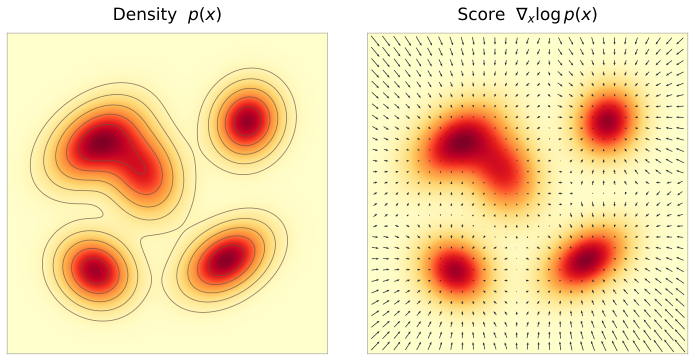
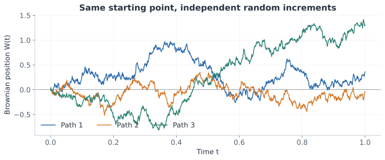

We talked about flow matching in the [previous post](). In this post, we will discuss a closely related family of generative models, diffusion models, and a way to train them called score matching.

## Background

In flow matching, we learned how to move samples from noise to data by predicting their velocity. Diffusion models offer another perspective:

**Can we learn to generate data by learning to denoise it?**

Adding noise to data is easy, and we can do it at different noise levels to construct training examples. Learning how to reverse that corruption gives us a route back from noise to data: generation becomes a sequence of denoising steps.

The surprising part is that denoising also tells us something about the underlying distribution. As we will see, predicting the added noise is closely related to learning the **score function**, which describes how log density changes around a sample. We can learn this local information without being able to evaluate the density itself.

Diffusion also introduces a different kind of dynamics. In the flow model we studied, fixing the initial noise fixes the entire trajectory. A diffusion process adds fresh randomness along the way, making the trajectory stochastic. This is a major distinction between the two formulations, even though both begin with random noise.

For the Gaussian probability paths in this post, the score connects directly to the velocity field we already know. This connection will let us see how denoising relates to flow matching, and how deterministic and stochastic trajectories can follow the same probability path.

## A Brief History

Diffusion models actually appeared before the modern flow-matching methods we discussed. They were like two separate rivers, but now they have converged in many ways. For the Gaussian probability paths in this post, we will see how scores and velocities describe the same evolving distribution, and how either can be used for deterministic or stochastic sampling. This connection does not make every flow and diffusion method identical, but it explains why the terminology sometimes overlaps.

Let's take a look at a short timeline.

- **2015 — Diffusion-based generative modeling.** [Sohl-Dickstein et al.](https://arxiv.org/abs/1503.03585) proposed gradually destroying structure with a forward diffusion process, then learning a reverse process that generates data.
- **2019 — Noise Conditional Score Networks (NCSN).** [Song and Ermon](https://arxiv.org/abs/1907.05600) learned scores at multiple noise levels and generated samples using annealed Langevin dynamics: noisy updates guided by scores, progressing from more noise to less noise.
- **2020 — Denoising Diffusion Probabilistic Models (DDPM).** [Ho et al.](https://arxiv.org/abs/2006.11239) demonstrated high-quality image generation with a simplified noise-prediction objective, helping make diffusion models widely used.
- **2020 — Denoising Diffusion Implicit Models (DDIM).** [Song, Meng, and Ermon](https://arxiv.org/abs/2010.02502) introduced a family of non-Markovian forward processes with the same training objective as DDPM. Their samplers include a deterministic case, connect to ODEs, and allow generation with fewer steps.
- **2020 — Score-based SDEs.** [Song et al.](https://arxiv.org/abs/2011.13456) unified earlier score-based and diffusion approaches in continuous time. They also derived a probability flow ODE with the same time marginals as the SDE.
- **2022 — Rectified Flow and Flow Matching.** [Liu et al.](https://arxiv.org/abs/2209.03003) and [Lipman et al.](https://arxiv.org/abs/2210.02747) developed related methods for learning flows from prescribed interpolations or conditional probability paths.

There are several ways to explain diffusion models. We will approach them through probability paths, keeping the connection to flow matching visible throughout.

## Score Function

In flow matching, we described how samples move using a vector field. Another useful quantity describes the distribution itself: which direction does its density increase? This leads us to the **score function**, the gradient of the log probability density with respect to the sample:

$$
s_t(x)=\nabla_x\log p_t(x).
$$

Its direction tells us which way the log density increases fastest locally, and its magnitude tells us how steep that increase is. Imagine standing on a landscape whose height is log density: the score points uphill.

For example, if $p(x)=\mathcal N(x;\mu,\sigma^2)$ in one dimension, then

$$
s(x)=-\frac{x-\mu}{\sigma^2}.
$$

To the left of the mean, the score points right; to the right, it points left. At the mean it is zero.

For a more complicated density, it follows the local landscape as the following figure shows.



*Left: a two-dimensional density map. Right: the same density with score vectors. The arrows point in the direction where log density increases fastest.*

### Conditional and Marginal Scores

Just as with vector fields, we can define conditional and marginal scores. Their relationship starts from the probability path:

$$
p_t(x)=\int p_t(x\mid z)\,p_{\mathrm{data}}(z)\,dz.
$$

For a fixed endpoint $z$, the **conditional score** is $s_t(x\mid z)=\nabla_x\log p_t(x\mid z)$. What we need for generation is the **marginal score** $s_t(x)=\nabla_x\log p_t(x)$. It turns out that the same posterior average connects them:

$$
\boxed{
s_t(x)=\int s_t(x\mid z)\,p_t(z\mid x)\,dz
=\mathbb E[s_t(x\mid Z)\mid X_t=x].
}
$$

At a given position $x$, each endpoint suggests a score, and $p_t(z\mid x)$ determines its contribution to the average. So the connection to flow matching goes beyond the terminology: both marginal fields are posterior expectations of their conditional counterparts. The short derivation is in the [appendix](#derivation-marginalizing-the-score).

### Scores for Gaussian Probability Paths

The marginalization formula becomes useful once we have a conditional score we can calculate. Let's return to the Gaussian paths from the previous post, keeping **noise at $t=0$ and data at $t=1$**. Note that this runs opposite to the forward noising convention used in many diffusion papers.

Draw independent samples $Z\sim p_{\mathrm{data}}$ and $\epsilon\sim\mathcal N(0,I_d)$, and construct

$$
X_t=\alpha_t Z+\beta_t\epsilon,
\qquad
p_t(x\mid z)=\mathcal N(x;\alpha_tz,\beta_t^2I_d).
$$

The schedules $\alpha_t$ and $\beta_t$ control the data and noise contributions. Their endpoint values are $\alpha_0=0$, $\beta_0=1$, $\alpha_1=1$, and $\beta_1=0$, with both positive in the interior. Our previous linear interpolation is the case $\alpha_t=t$, $\beta_t=1-t$.

Differentiating the Gaussian log density gives

$$
\boxed{
s_t(x\mid z)=-\frac{x-\alpha_tz}{\beta_t^2}.
}
$$

In particular, at a sampled point $X_t=\alpha_tz+\beta_t\epsilon$,

$$
s_t(X_t\mid z)=-\frac{\epsilon}{\beta_t}.
$$

So the conditional score is just the added noise, rescaled and negated. We now have a target we can calculate for every noisy training sample—the ingredient we will need for score matching.

## From ODEs to SDEs

In the previous post, each sample followed a deterministic trajectory once its initial noise was fixed. Can we make these trajectories stochastic while preserving the same probability path? Suppose $u_t$ generates $p_t$ through the ODE

$$
dX_t=u_t(X_t)\,dt.
$$

We need both a source of randomness and a drift correction that keeps the distribution on the same path. Brownian motion provides the first; the score provides the second.

### Brownian Motion

**Brownian motion**, written $W_t$, is the continuous-time limit of a suitably scaled random walk. Its defining property is the distribution of its increments: in $d$ dimensions, $W_0=0$ and

$$
W_{t+h}-W_t\sim\mathcal N(0,hI_d),
$$

with independent increments over disjoint time intervals.

An increment over a time step $h$ therefore has scale $\sqrt h$. This scaling will appear directly in our sampler. Brownian paths are continuous but almost surely nowhere differentiable, so $dW_t$ denotes a stochastic increment rather than an ordinary velocity multiplied by $dt$.



*Three Brownian paths sampled on a finite time grid.*

### Adding Noise Without Changing the Probability Path

Adding Brownian noise turns the ODE into a **stochastic differential equation**, or SDE. But simply adding noise also changes how the distribution evolves: the random fluctuations spread probability mass, so we no longer follow the original probability path. How can we compensate for that spreading? Recall that the score points toward increasing log density. Adding a drift in this direction can counteract the spreading caused by noise. The balance requires a specific coefficient, giving us

$$
\boxed{
dX_t=
\left[u_t(X_t)+\frac{\sigma_t^2}{2}s_t(X_t)\right]dt
+\sigma_t\,dW_t,
\qquad X_0\sim p_{\mathrm{init}}.
}
$$

Here, $\sigma_t\geq0$ is a scalar noise amplitude that depends only on time. The score correction $\frac{\sigma_t^2}{2}\,s_t$ is what allows the SDE to follow the ODE's probability path. With exact fields and suitable regularity, both have marginal distribution $p_t$ at every time; $\sigma_t=0$ recovers the ODE.

The above equation is interesting. Individual samples now wander along different routes, but their distribution evolves in the same way! Brownian motion spreads probability mass, while the score drift pushes it toward higher density. These effects balance at the level of the density, even as individual trajectories change.

Why does this particular correction preserve the probability path? The **Fokker–Planck equation** describes how the SDE changes the density over time. Substituting our drift into it shows that the score correction exactly cancels the diffusion term, leaving the same density evolution as the original ODE. The derivation is in the [appendix](#proof-preserving-the-probability-path). With learned fields and numerical sampling, this equality holds only approximately.

## Vector Fields, Scores, and a Unified Perspective

You might have noticed that our SDE contains both a vector field and a score. Does that mean we need to train two models?

For our Gaussian paths, the same interpolation determines both fields, so we can express one in terms of the other.

For the velocity field obtained from the interpolation $X_t=\alpha_tZ+\beta_t\epsilon$, posterior averaging gives the conversion

$$
\boxed{
u_t(x)=\frac{\dot\alpha_t}{\alpha_t}x+
\left(\frac{\dot\alpha_t}{\alpha_t}\beta_t^2
-\beta_t\dot\beta_t\right)s_t(x).
}
$$

A dot denotes differentiation with respect to time. The schedule terms are known, so predicting the score also gives us the velocity. Solving for the score gives the reverse conversion wherever its coefficient is nonzero. The [appendix](#derivation-converting-velocities-and-scores) derives the formula and discusses its endpoint conditions.

For our running example, $\alpha_t=t$ and $\beta_t=1-t$, this becomes

$$
\begin{aligned}
u_t(x)&=\frac{x}{t}+\frac{1-t}{t}s_t(x),\\
s_t(x)&=\frac{t\,u_t(x)-x}{1-t},
\qquad 0\lt t\lt 1.
\end{aligned}
$$

This gives us a concrete way to reuse the velocity network $v_\theta(x,t)$ from the previous post. Its corresponding score estimate is

$$
s_\theta(x,t)=\frac{t\,v_\theta(x,t)-x}{1-t}
$$

which we can insert into the stochastic sampler. The reverse route works too: train a score network, convert its output to a velocity, and sample with an ODE.

This is the unified perspective I find useful: **the prediction target and the sampling dynamics are separate choices**. Either score or velocity predictions can drive deterministic or stochastic sampling. The probability flow ODE in the [score-SDE paper](https://arxiv.org/abs/2011.13456) is another expression of this connection.

The conversion applies to the Gaussian interpolation and its associated velocity field. It relates prediction targets; separately trained networks can still differ because of their loss weighting and approximation errors.

## Score Matching

We have a sampler and a target score. What remains is to learn that score from data. As in flow matching, the natural starting point is regression against the marginal field:

$$
\mathcal L_{\mathrm{SM}}(\theta)=
\mathbb E_{t,\,X_t\sim p_t}
\left[\|s_\theta(X_t,t)-s_t(X_t)\|^2\right].
$$

We sample time uniformly, staying slightly away from the endpoints as in the code below. The marginal score is unavailable, but our conditional score is explicit. Can we train against that instead?

The posterior-expectation identity gives us the same answer as in flow matching. Use the conditional objective

$$
\mathcal L_{\mathrm{CSM}}(\theta)=
\mathbb E_{t,\,Z,\,\epsilon}
\left[
\left\|
s_\theta(\alpha_tZ+\beta_t\epsilon,t)
+\frac{\epsilon}{\beta_t}
\right\|^2
\right].
$$

where $Z\sim p_{\mathrm{data}}$ and $\epsilon\sim\mathcal N(0,I_d)$ are independent. With the same time sampling, the two losses differ by a term independent of $\theta$, provided their expectations are finite. Their parameter gradients therefore agree—the same conditional-expectation argument we used in the previous post.

### Predicting Noise Instead

The conditional target $-\epsilon/\beta_t$ grows as $\beta_t$ approaches zero, making direct score regression poorly scaled near the data endpoint. Since we already know the factor $-1/\beta_t$, why ask the network to learn that scaling too? Let it predict the noise and recover the score through

$$
s_\theta(x,t)=-\frac{\epsilon_\theta(x,t)}{\beta_t}.
$$

Substitution into the conditional loss gives

$$
\mathcal L_{\mathrm{CSM}}(\theta)=
\mathbb E_{t,\,Z,\,\epsilon}
\left[
\frac{1}{\beta_t^2}
\|\epsilon_\theta(X_t,t)-\epsilon\|^2
\right].
$$

The factor $1/\beta_t^2$ still gives much more weight to times near the data endpoint. A common simplification is to drop that factor and train with ordinary noise-prediction error:

$$
\boxed{
\mathcal L_{\mathrm{noise}}(\theta)=
\mathbb E_{t,\,Z,\,\epsilon}
\left[\|\epsilon_\theta(\alpha_tZ+\beta_t\epsilon,t)-\epsilon\|^2\right].
}
$$

This step changes the relative weighting across time. Unlike replacing the marginal score target with a conditional one, it changes the training objective: $1/\beta_t^2$ depends on $t$, so it is not a constant we can simply discard without consequence.

This is the noise-prediction idea behind [DDPM's simplified training objective](https://arxiv.org/abs/2006.11239), applied here with our linear schedule. DDPM uses a different schedule, and other models choose clean data or velocity as their prediction target.

What does the noise predictor learn? Several data–noise pairs can lead to the same $x_t$, so the squared-error optimum is the conditional mean $\mathbb E[\epsilon\mid X_t=x]$. Dividing that mean by $-\beta_t$ recovers the marginal score. The posterior averaging appears again, now through the regression objective.

### PyTorch Example

The training step now looks almost identical to the flow-matching example: construct the same interpolation, then change the regression target from velocity to noise. Assume `sample_data`, `model`, and `batch_size` are defined, with data and predictions shaped `[batch, d]`.

```python
z = sample_data(batch_size)
noise = torch.randn_like(z)

# Avoid the singular endpoints in this introductory example.
time_margin = 1e-3
t = time_margin + (1 - 2 * time_margin) * torch.rand(
    z.shape[0], 1, device=z.device, dtype=z.dtype
)

xt = t * z + (1 - t) * noise
predicted_noise = model(xt, t)
loss = (predicted_noise - noise).square().sum(-1).mean()
```

The loss sums over coordinates and averages over the batch. We exclude a small interval at each endpoint, as discussed in the [appendix](#practical-note-endpoints). Like flow matching, this training step constructs its targets directly, without simulating a trajectory.

## Sampling

With a trained noise predictor, we can assemble the sampler. For the linear schedule, the score and velocity estimates are

$$
\begin{aligned}
s_\theta(x,t)&=-\frac{\epsilon_\theta(x,t)}{1-t},\\
u_\theta(x,t)&=\frac{x-\epsilon_\theta(x,t)}{t}.
\end{aligned}
$$

The velocity expression follows directly from the score conversion. A model trained on velocity would supply $u_\theta$ directly, with $s_\theta$ obtained from the inverse relation.

We can now extend the previous post's Euler sampler to **Euler–Maruyama**. For a positive time step $h_k=t_{k+1}-t_k$, the update is

$$
\boxed{
x_{k+1}=x_k+
\left[u_\theta(x_k,t_k)+\frac{\sigma_{t_k}^2}{2}s_\theta(x_k,t_k)\right]h_k
+\sigma_{t_k}\sqrt{h_k}\,\xi_k,
\qquad \xi_k\sim\mathcal N(0,I_d).
}
$$

Each step uses a fresh, independent $\xi_k$. The factor $\sqrt{h_k}$ is the Brownian scaling we introduced earlier.

Starting from Gaussian noise, we repeat these updates toward the data endpoint. For the formulas above, use a grid from $\delta$ to $1-\delta$, with $\delta=10^{-3}$ as in the training example, and take the final state as an approximate data sample. The cutoff avoids singular endpoint expressions; the [appendix](#practical-note-endpoints) explains the resulting approximation.

### Choosing the Diffusion Coefficient

The sampler gives us one more choice: how much fresh noise to add at each step. This is controlled by $\sigma_t$. Recall that $\beta_t$ defines the noise level in our probability path; $\sigma_t$ controls the randomness of the trajectories that follow it. Different choices of $\sigma_t$, paired with the corresponding score correction, can preserve the same probability path.

A simple family to experiment with is

$$
\sigma_t=c\sqrt{1-t},\qquad c\geq0.
$$

This tapers the injected noise toward the data endpoint. At $c=0$, sampling is deterministic once the initial noise is fixed. Positive values allow different continuations from the same state.

Changing $\sigma_t$ also changes the drift correction $\frac{\sigma_t^2}{2}\,s_\theta$; together, they preserve the ideal probability path. Learned fields and finite steps break that exact balance, so the choice can affect sampling quality.

Treat $c$ as a sampling hyperparameter. Compare $c=0$ with a few positive values at a fixed sampling budget, evaluating quality on held-out data. Larger amplitudes can require smaller steps, so the useful amount of noise depends on both the model and the solver.

### PyTorch Sampling Example

Let's put these pieces together. The model predicts noise, which we convert to a score and velocity at each step. We use the same linear path and endpoint cutoff as in training, with $\sigma_t=c\sqrt{1-t}$.

```python
import torch


@torch.no_grad()
def sample(model, x0, steps=500, c=0.5):
    # x0 is standard Gaussian noise with shape [batch, d].
    x = x0.clone()
    time_margin = 1e-3
    h = (1 - 2 * time_margin) / steps

    for k in range(steps):
        time = time_margin + k * h
        t = x.new_full((x.shape[0], 1), time)

        predicted_noise = model(x, t)
        score = -predicted_noise / (1 - time)
        velocity = (x - predicted_noise) / time
        sigma = c * (1 - time) ** 0.5

        drift = velocity + 0.5 * sigma**2 * score
        x = x + h * drift
        if c > 0:
            x = x + sigma * h**0.5 * torch.randn_like(x)

    return x


model.eval()
# Match the training data's dimension, device, and dtype.
x0 = torch.randn(batch_size, d, device=device, dtype=dtype)
samples = sample(model, x0, steps=500, c=0.5)
```

Here, `model` is the trained noise predictor, and `d`, `device`, and `dtype` match its training inputs. Each step evaluates the model once and, when $c>0$, draws fresh Gaussian noise. Setting `c=0` removes both the noise and its drift correction, recovering Euler sampling of the ODE. With a fixed `x0` and a deterministic model evaluation, that trajectory is deterministic.

The returned samples are at $t=1-\delta$, with the endpoint approximation described above. The values `steps=500` and `c=0.5` are starting points for experimentation.

## Summary

We started with a question: can we learn to generate data by learning to denoise it? The score connects the denoising task to the dynamics that carry samples from noise to data.

For training, we sample data, time, and Gaussian noise, construct $X_t=\alpha_tZ+\beta_t\epsilon$, and regress against a target we can calculate. Predicting noise and dropping the time-dependent factor $1/\beta_t^2$ gives a simple squared-error loss between predicted and sampled noise. This simplification reweights the original score-matching objective across time.

For sampling, we start from noise and integrate an ODE or SDE. The stochastic version adds both Brownian noise and the corresponding score correction. The trajectories change, while the ideal time marginals stay the same.

For the Gaussian paths considered here, scores and their associated velocities can be converted into each other. So a network trained with score matching can drive an ODE, and a network trained with flow matching can drive an SDE. That is where the two rivers meet.

## Appendix

### Derivation: Marginalizing the Score

Assume $p_t$ is positive and differentiable, and differentiation can pass under the integral. Then

$$
\begin{aligned}
s_t(x)
&=\frac{\nabla_x p_t(x)}{p_t(x)}\\
&=\frac{1}{p_t(x)}\int \nabla_xp_t(x\mid z)\,p_{\mathrm{data}}(z)\,dz\\
&=\int \nabla_x\log p_t(x\mid z)
\frac{p_t(x\mid z)p_{\mathrm{data}}(z)}{p_t(x)}\,dz\\
&=\int s_t(x\mid z)\,p_t(z\mid x)\,dz.
\end{aligned}
$$

The last step is Bayes' rule. For an empirical dataset, the integral over endpoints becomes a sum; positive Gaussian noise still gives a smooth marginal density.

### Proof: Preserving the Probability Path

To see why the correction works, we need the density evolution equation for an SDE. Its diffusion term uses the **Laplacian**, the sum of second derivatives of a scalar function $f:\mathbb R^d\to\mathbb R$:

$$
\Delta f=\sum_{i=1}^{d}\frac{\partial^2f}{\partial x_i^2}
=\nabla\cdot(\nabla f).
$$

In one dimension this reduces to $f''$; in the density equation, it describes the smoothing effect of diffusion.

For the Itô SDE $dX_t=b_t(X_t)dt+\sigma_t dW_t$, with $\sigma_t$ depending only on time, the Fokker–Planck equation is

$$
\partial_t p_t=-\nabla\cdot(p_tb_t)+\frac{\sigma_t^2}{2}\Delta p_t.
$$

Our original ODE satisfies the continuity equation

$$
\partial_t p_t=-\nabla\cdot(p_tu_t).
$$

Choose $b_t=u_t+\frac{\sigma_t^2}{2}\,s_t$. Since $p_ts_t=\nabla p_t$, the Fokker–Planck right-hand side becomes

$$
\begin{aligned}
-\nabla\cdot\left[p_t\left(u_t+\frac{\sigma_t^2}{2}s_t\right)\right]
+\frac{\sigma_t^2}{2}\Delta p_t
&=-\nabla\cdot(p_tu_t)
-\frac{\sigma_t^2}{2}\nabla\cdot(\nabla p_t)
+\frac{\sigma_t^2}{2}\Delta p_t\\
&=-\nabla\cdot(p_tu_t).
\end{aligned}
$$

The two score and diffusion terms cancel, leaving the original continuity equation. With a common initial distribution and uniqueness of the density evolution, the ODE and SDE therefore share the same time marginals. This argument assumes sufficient smoothness, suitable decay at infinity, and well-posed dynamics on the interval considered. State-dependent diffusion coefficients require additional terms.

### Derivation: Converting Velocities and Scores

Both fields come from the same Gaussian interpolation. To obtain its velocity, differentiate while holding $z$ and $\epsilon$ fixed:

$$
\frac{d}{dt}(\alpha_tz+\beta_t\epsilon)
=\dot\alpha_tz+\dot\beta_t\epsilon.
$$

Substituting $\epsilon=(x-\alpha_tz)/\beta_t$ gives the conditional field

$$
u_t(x\mid z)=\frac{\dot\beta_t}{\beta_t}x+
\left(\dot\alpha_t-\frac{\dot\beta_t}{\beta_t}\alpha_t\right)z.
$$

Average over the posterior endpoint distribution. Writing $m_t(x)=\mathbb E[Z\mid X_t=x]$, we obtain

$$
u_t(x)=\frac{\dot\beta_t}{\beta_t}x+
\left(\dot\alpha_t-\frac{\dot\beta_t}{\beta_t}\alpha_t\right)m_t(x).
$$

The score gives us another expression involving the same posterior mean:

$$
s_t(x)=-\frac{x-\alpha_tm_t(x)}{\beta_t^2},
\qquad
m_t(x)=\frac{x+\beta_t^2s_t(x)}{\alpha_t}.
$$

Eliminating $m_t$ connects the two fields:

$$
u_t(x)=\frac{\dot\alpha_t}{\alpha_t}x+
\underbrace{\left(\frac{\dot\alpha_t}{\alpha_t}\beta_t^2
-\beta_t\dot\beta_t\right)}_{B_t}s_t(x).
$$

Where $B_t\neq0$, the inverse is

$$
s_t(x)=\frac{u_t(x)-(\dot\alpha_t/\alpha_t)x}{B_t}.
$$

These formulas assume differentiable schedules with $\alpha_t,\beta_t>0$ at the times being evaluated. For the linear schedule, $B_t=(1-t)/t$ is nonzero throughout $(0,1)$. At the endpoints, direct substitution can divide by zero; limits or a different parameterization are needed. At a noise-free data endpoint, a smooth score may not even exist, especially for an empirical data distribution.

A probability path alone does not determine a unique velocity field. The conversion above is for the field obtained by posterior-averaging the velocities of this interpolation. Adding an arbitrary field $w_t$ with $\nabla\cdot(p_tw_t)=0$ leaves the density evolution unchanged but generally breaks this particular conversion formula.

### Practical Note: Endpoints

The noise-to-data path runs from $t=0$ to $t=1$, but the score and velocity conversions can be singular at those endpoints. The code therefore samples time in $(\delta,1-\delta)$ with $\delta=10^{-3}$. The marginal–conditional loss equivalence continues to hold when both objectives use this shortened interval.

For sampling, initialize $x_\delta$ with standard Gaussian noise, integrate over the shortened interval, and use $x_{1-\delta}$ as an approximate data sample. This introduces two endpoint approximations: standard Gaussian noise approximates $p_\delta$, and $p_{1-\delta}$ still contains residual noise. The cutoff avoids direct evaluation of singular expressions; its accuracy depends on how well these approximations suit the data and schedules.
