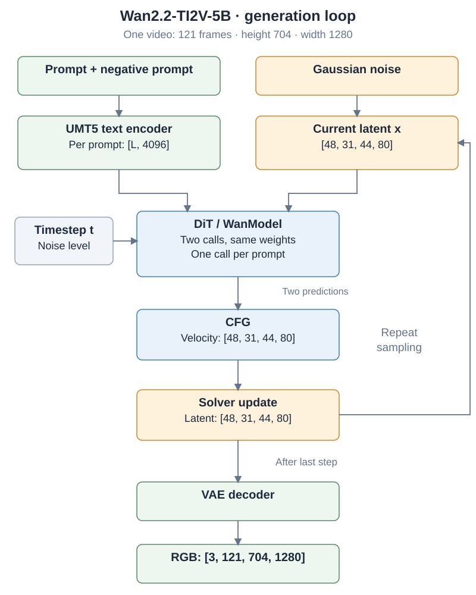
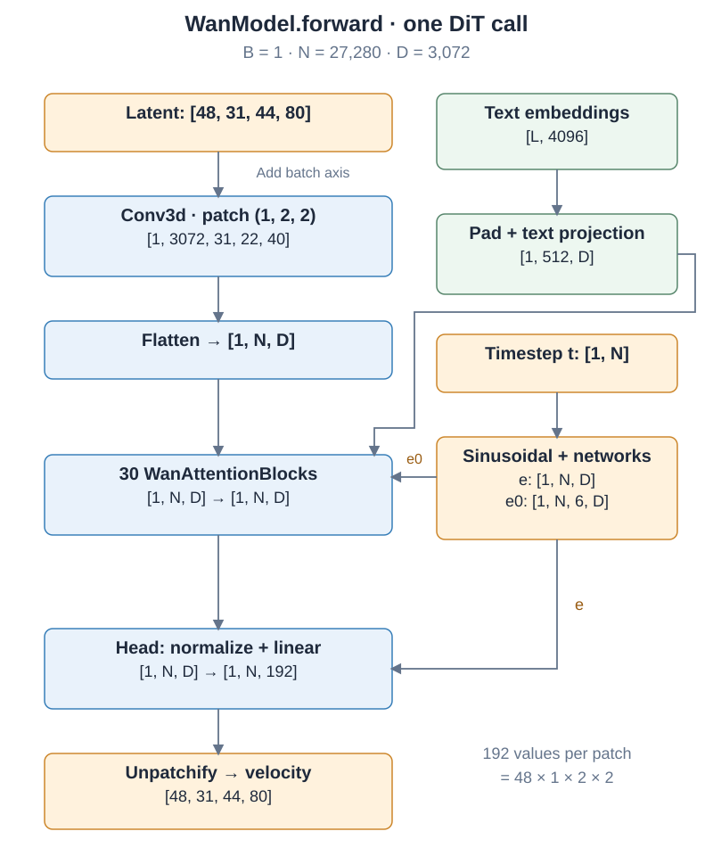
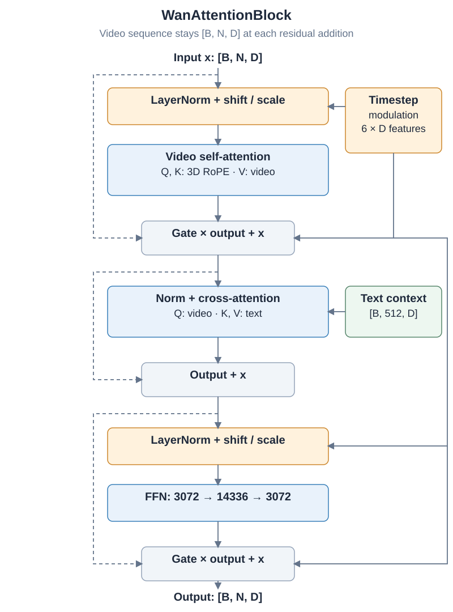

In previous posts, we covered the foundations of modern image and video generation: [flow matching](), [classifier-free guidance](), and [latent space](). But there is still a gap between understanding these ideas separately and understanding how a real video generator works. In this post, we will use **[Wan2.2](https://github.com/Wan-Video/Wan2.2)**, an open-source video generation model from Alibaba, as a case study to connect them.

Wan2.2 is built on **[diffusion transformers (DiTs)](https://arxiv.org/abs/2212.09748)**, which use transformers to process latent patches and predict updates during generation. There are many articles explaining Wan2.2 and DiTs. What I want to focus on here is the connection between the concepts and the actual code. When we say a model "turns noise into video," what passes through the network? How do the shapes change? And where does the text prompt come in?

We will take a top-down approach: first the generation pipeline, then the DiT forward pass, then the modules inside an attention block. To keep the scope manageable, we will use **Wan2.2-TI2V-5B**, running **text-to-video inference**. It also supports image-to-video, but we will leave that branch aside. One distinction worth making early: this is a dense model with one DiT, while the A14B models use separate high-noise and low-noise experts. See the [official model overview](https://github.com/Wan-Video/Wan2.2/tree/1ea34ff48f87168174e12956e200b1d908b1c5ff#introduction-of-wan22).

The goal is to understand the main pieces well enough to follow the source code. We will assume some familiarity with transformers.

## Foundations

A video is a stack of image frames, so generating a video means modeling both what appears in each frame and how it changes over time. By treating the whole video as one sample, we can apply the same flow matching method as in image generation.

Recall that flow matching gives us a network that learns a **vector field**, which predicts the **velocity** of a sample at each timestep. A numerical solver repeatedly uses those predictions to move a sample from noise toward data. In Wan2.2, that network is a DiT, and the sample is a video latent.

But how does a transformer process a video latent? A transformer works on a sequence of tokens, so the DiT first splits the latent into small patches and projects each patch into a feature vector. Each vector becomes a **video token**. This is the tokenization step: it turns the latent grid into a sequence the transformer can process.

The transformer then processes these tokens **together** with information from the **text prompt** and the current **timestep**. Finally, an output layer predicts the velocity values for each patch, and we rearrange those patches back into the original latent shape. So a DiT call follows **latent → tokens → transformer blocks → latent-shaped velocity**.

The [original DiT paper](https://arxiv.org/abs/2212.09748) introduced this approach for images. Wan2.2 extends it to video, where patches have positions across **both space and time**.

### Overall Flow

For a prompt such as "a corgi running through the snow," generation follows this sequence:

1. A **UMT5 text encoder** separately converts our prompt and a negative prompt into text embeddings.
2. We sample Gaussian noise with the shape of a video latent.
3. At each sampling step, we call the same **DiT twice**: once with our prompt's embeddings and once with the negative prompt's embeddings. Both calls receive the same latent and timestep, and each predicts a velocity with the same shape as the latent.
4. **CFG** combines these two predictions to strengthen the prompt's influence, then the solver updates the latent.
5. After the last step, the **VAE decoder** converts the generated latent into RGB frames.



For text-to-video, we do not need the VAE encoder: there is no input video to compress. We start directly from noise in its latent space.

One thing worth mentioning: our earlier posts used $t=0$ for noise and $t=1$ for data. Wan uses the opposite convention. Using normalized time $t\in[0,1]$, we start from noise at $t=1$ and move toward data at $t=0$:

$$
x_t=(1-t)z+t\epsilon,
\qquad
\frac{dx_t}{dt}=\epsilon-z.
$$

Here, $z$ is a clean video latent and $\epsilon$ is noise. An illustrative Euler update would be $x_{\mathrm{next}}=x+(t_{\mathrm{next}}-t)v_\theta$, where $t_{\mathrm{next}}\lt t$. The actual implementation uses UniPC or DPM++ to follow the predicted field.

### Classifier-Free Guidance

The basic idea of classifier-free guidance (CFG) is to **call the same model twice**: once with our text prompt and once with an empty string. Comparing the predictions tells us how the prompt changes the predicted velocity, and CFG amplifies that difference. Wan2.2 uses the same idea, but gives the second call a **negative prompt** describing unwanted results, such as blur or low quality.

Let $v_{\mathrm{prompt}}$ be the prediction using our prompt and $v_{\mathrm{neg}}$ the prediction using the negative prompt. Both calls use the same latent and timestep. We combine them as

$$
v_{\mathrm{guided}}
=v_{\mathrm{neg}}+s\left(v_{\mathrm{prompt}}-v_{\mathrm{neg}}\right).
$$

Here, $s$ controls how strongly we amplify the difference. At $s=1$, we get the ordinary prompt prediction; with $s>1$, we push further in the direction from the negative-prompt prediction toward our prompt prediction. The solver then uses this combined velocity to update the latent.

### Shapes

Let's follow one example throughout: **121 frames at height 704 and width 1280**, with batch size $B=1$. This matches a supported resolution and the frame count in the [5B model configuration](https://github.com/Wan-Video/Wan2.2/blob/1ea34ff48f87168174e12956e200b1d908b1c5ff/wan/configs/wan_ti2v_5B.py).

The Wan2.2 VAE uses 48 latent channels and compression strides $(4,16,16)$ in time, height, and width. The first frame is handled separately by the temporal compression, so for $F=121$ frames, the latent frame count is $(F-1)/4+1$, rather than $F/4$:

$$
T=31,\qquad H_\ell=704/16=44,\qquad W_\ell=1280/16=80.
$$

The DiT then groups the latent into patches of size $(1,2,2)$, giving

$$
N=T\cdot(H_\ell/2)\cdot(W_\ell/2)
=31\cdot22\cdot40=27{,}280
$$

video tokens. We use $D=3072$ for their hidden dimension and $L$ for the prompt's encoded length, up to 512.

| Tensor | Shape in our example |
| --- | --- |
| Initial noise / current video latent | `[48, 31, 44, 80]` |
| UMT5 output for one prompt | `[L, 4096]` |
| Video tokens inside the DiT | `[1, 27280, 3072]` |
| Padded, projected text context | `[1, 512, 3072]` |
| Per-token noise timesteps passed by the pipeline | `[1, 27280]` |
| DiT velocity prediction | `[48, 31, 44, 80]` |
| Decoded RGB video | `[3, 121, 704, 1280]` |

In the code, video latents and text embeddings are passed as Python lists, with one tensor per sample. The table shows the shapes of those tensors; the DiT adds the batch dimension internally.

### Sampling Loop

With these shapes in mind, we can write the generation pipeline as a short piece of pseudo code. The model calls below use simplified interfaces that handle list and batch dimensions internally.

```python
text = text_encoder(prompt)                 # [L_prompt, 4096]
text_neg = text_encoder(negative_prompt)     # [L_neg, 4096]

x = randn(48, 31, 44, 80)                   # Initial video latent
N = 31 * 22 * 40                            # 27280 video tokens
solver.set_timesteps(num_steps)

for t in solver.timesteps:                  # High noise toward zero
    token_t = full((1, N), t)               # Same timestep for every token

    # Each DiT call returns a velocity with shape [48, 31, 44, 80].
    v_pos = dit(x, token_t, text)
    v_neg = dit(x, token_t, text_neg)
    v = v_neg + guidance_scale * (v_pos - v_neg)

    x = solver.step(v, t, x)                # Updated latent: [48, 31, 44, 80]

video = vae.decode(x)                       # RGB frames: [3, 121, 704, 1280]
```

The text embeddings are computed once and reused throughout sampling. Each step updates the whole video latent, and the VAE decodes it only after the loop finishes.

## WanModel

Now let's look inside a single DiT call. `WanModel` turns the latent into tokens, processes them through **30 attention blocks**, and turns their outputs back into a latent-shaped velocity.



Below, we will use the official [model.py](https://github.com/Wan-Video/Wan2.2/blob/1ea34ff48f87168174e12956e200b1d908b1c5ff/wan/modules/model.py) to explain each module, connecting the concepts to the code as we aim to do.

### From Latents to Tokens

To feed the latent into a transformer, we need to turn it into a sequence of vectors. Wan does this by dividing the latent into non-overlapping patches of size $(1,2,2)$: one latent frame and a $2\times2$ spatial region. Each patch includes all 48 channels, giving $48\times1\times2\times2=192$ values. A learned **patch embedding** maps these values to a vector of length 3072, which we call **a video token**:

```python
self.patch_embedding = nn.Conv3d(
    in_dim, dim, kernel_size=patch_size, stride=patch_size)
```

For our latent, this produces a $31\times22\times40$ grid of tokens. We then flatten that grid into a sequence of $27{,}280$ tokens, keeping each token's 3072 features together.

```python
x = [self.patch_embedding(u.unsqueeze(0)) for u in x]
grid_sizes = torch.stack(
    [torch.tensor(u.shape[2:], dtype=torch.long) for u in x])
x = [u.flatten(2).transpose(1, 2) for u in x]
```

Including the batch dimension, the shapes change as follows:

$$
\underbrace{[1,48,31,44,80]}_{\text{latent}}
\rightarrow\underbrace{[1,3072,31,22,40]}_{\text{patch embeddings}}
\rightarrow\underbrace{[1,27280,3072]}_{\text{token sequence}}.
$$

The final dimensions are ordered as **[batch, tokens, features]**. We also save the grid dimensions in `grid_sizes`, so we can track the tokens' positions and put the output patches back together later.

### Text Input

The text branch pads the UMT5 embeddings to 512 positions, then `self.text_embedding` projects them from 4096 to 3072 dimensions. `self.text_embedding` consists of two linear layers and a GELU activation:

```python
context = self.text_embedding(
    torch.stack([
        torch.cat(
            [u, u.new_zeros(self.text_len - u.size(0), u.size(1))])
        for u in context
    ]))
```

Text and video remain separate sequences, cross-attention later will connect them inside each block.

### Timestep Input

Recall that in flow matching, we learn a time-dependent vector field $v_\theta(x_t,t)$. Its prediction depends on both the current latent $x_t$ and the timestep $t$. We have turned the latent into tokens, but **how do we inject the timestep into the model?** Here, $t$ is the time along the flow, rather than a frame's position within the video.

`WanModel` first converts the timestep into 256 sinusoidal features, then maps them to a 3072-dimensional embedding `e`. A further projection produces six modulation vectors `e0`:

```python
e = self.time_embedding(
    sinusoidal_embedding_1d(self.freq_dim,
                            t).unflatten(0, (bt, seq_len)).float())
e0 = self.time_projection(e).unflatten(2, (6, self.dim))
```

`time_embedding` consists of two linear layers with a SiLU activation between them. Here, `t` has already been flattened, and `bt` is the batch size. The embedding `e` has shape `[1, N, 3072]`; `e0` has shape `[1, N, 6, 3072]`. In our simple text-to-video setting, every video token receives the same timestep.

Using the timestep to scale and shift normalized token features is called **adaptive layer normalization (AdaLN)**. This lets the model adjust its behavior at different noise levels. We will see how the blocks apply these vectors [below](#adaln-and-residual-gates).

### Blocks and Output Head

The video tokens pass through 30 attention blocks, the **core modules of Wan2.2's DiT**. They model relationships across the video and incorporate the text prompt and timestep. We will look inside them in the [Attention Block section](#attention-block). Each block keeps the token shape `[1, N, 3072]`:

```python
for block in self.blocks:
    x = block(x, **kwargs)
```

After the blocks, each token still contains 3072 features describing its patch. The output head `self.head(x, e)` converts these features to **192 velocity values**, corresponding to the $48\times1\times2\times2$ values in one latent patch. The head's forward pass applies timestep-conditioned normalization followed by a linear projection:

```python
e = (self.modulation.unsqueeze(0) + e.unsqueeze(2)).chunk(2, dim=2)
x = self.head(
    self.norm(x) * (1 + e[1].squeeze(2)) + e[0].squeeze(2))
```

The timestep embedding combines with two learned vectors to provide a shift and scale for the normalized features. Within this class, `self.head` is the linear layer that projects those features to 192 values, giving a sequence of patch predictions with shape `[1, N, 192]`.

### Unpatchifying

The solver needs a velocity tensor with the same shape as the input latent, but our predictions are still arranged as a sequence of patches. **Unpatchifying** puts these patches back into their positions in the latent grid:

```python
x = self.unpatchify(x, grid_sizes)
return [u.float() for u in x]
```

Recall that we saved the patch grid dimensions in `grid_sizes` when creating the tokens. Inside `unpatchify`, these dimensions tell us how to arrange the sequence back into frames, rows, and columns:

```python
u = u[:math.prod(v)].view(*v, *self.patch_size, c)
u = torch.einsum('fhwpqrc->cfphqwr', u)
u = u.reshape(c, *[i * j for i, j in zip(v, self.patch_size)])
```

Here, `v=(31,22,40)` is the patch grid and `c=48`. Combining the grid with the patch size `(1,2,2)` gives a velocity tensor of shape `[48,31,44,80]`, ready for the solver to update the latent. Unpatchifying only rearranges the predicted values; the VAE decoder converts the final latent into RGB frames after sampling finishes.

## Attention Block

We now come to the core of Wan2.2’s DiT: `WanAttentionBlock`.

Each `WanAttentionBlock` updates the video tokens using information from the video, the text prompt, and the flow timestep. The input sequence has shape `[B, N, D]`, where our example has $B=1$, $N=27{,}280$, and $D=3072$. The block contains three main operations:

- **Self-attention** lets video tokens exchange information across space and time.
- **Cross-attention** brings information from the text prompt into the video tokens.
- A **feed-forward network (FFN)** processes the features at each token position.

Each operation produces an update that is added to the existing token features. This is a **residual connection**, written as $x_{\text{out}}=x_{\text{in}}+y$, where $y$ is the update. The sequence keeps the same shape as it passes through the block.



### AdaLN and Residual Gates

In [Timestep Input](#timestep-input), we saw how `WanModel` turns the timestep into modulation vectors. **AdaLN** uses these vectors to inject the timestep into the block by scaling and shifting the token features after layer normalization. These scales and shifts depend on the timestep embedding, so the features passed into self-attention and the FFN change with $t$. This is how the block uses time to predict the velocity $v_\theta(x_t,t)$.

Wan also uses timestep-dependent **residual gates** to control the updates added back to the tokens. Together, AdaLN and these gates use the six modulation vectors prepared by `WanModel`. Each block adds its own learned parameters, then separates the vectors:

```python
e = (self.modulation.unsqueeze(0) + e).chunk(6, dim=2)
```

The first three vectors control self-attention: `e[0]` shifts the normalized features, `e[1]` scales them, and `e[2]` scales the residual update. The other three do the same for the FFN.

For self-attention, the scale and shift are applied after layer normalization and before computing attention:

```python
y = self.self_attn(
    self.norm1(x).float() * (1 + e[1].squeeze(2)) + e[0].squeeze(2),
    seq_lens, grid_sizes, freqs)
x = x + y * e[2].squeeze(2)
```

Here, `1 + e[1]` and `e[0]` are AdaLN's scale and shift. After attention produces an update `y`, the gate `e[2]` scales that update before it is added back to `x`. Both operations act feature by feature, giving the timestep control over the block's input features and its residual update.

### Self-Attention

Patches showing the same subject across frames need to stay consistent in appearance and motion. Self-attention lets each video token gather information from other tokens across space and time, helping the model capture these relationships.

Each token is projected into a query, key, and value. Queries and keys determine how strongly tokens attend to one another; values carry the information being combined:

```python
q = self.norm_q(self.q(x)).view(b, s, n, d)
k = self.norm_k(self.k(x)).view(b, s, n, d)
v = self.v(x).view(b, s, n, d)
```

Wan splits the 3072 features into 24 attention heads, each with 128 features. In the code, `s=N`, `n=24`, and `d=128`, so all three tensors have shape `[1, N, 24, 128]`. Queries and keys also receive RMS normalization before the head split.

You may notice that only $Q$ and $K$ are normalized. Their dot products determine the attention weights, so controlling their scale helps prevent the softmax from becoming overly concentrated on a few positions. This is the motivation behind [query–key normalization](https://arxiv.org/abs/2010.04245). $V$ carries the features combined by those weights and does not enter the softmax, so Wan leaves the projected values unnormalized. This is a design choice, not a requirement of attention.

Within each head, query–key comparisons determine the weights used to combine the values:

$$
\operatorname{Attention}(Q,K,V)
=\operatorname{softmax}\left(\frac{QK^\top}{\sqrt{128}}\right)V.
$$

The softmax normalizes these weights for each query. Before computing attention, Wan applies `rope_apply` to $Q$ and $K$ so that the weights also depend on the tokens' positions:

```python
x = flash_attention(
    q=rope_apply(q, grid_sizes, freqs),
    k=rope_apply(k, grid_sizes, freqs),
    v=v,
    k_lens=seq_lens,
    window_size=self.window_size)
```

The 5B model uses global attention, so each token can attend across **all latent frames**, including later ones. The whole video is refined together. [FlashAttention](https://arxiv.org/abs/2205.14135) computes this without storing the full $N\times N$ attention matrix, which would be expensive for our long video sequence.

The 24 heads are then combined and linearly projected back to `[B, N, D]`. This is the update `y` used in the gated residual addition above.

### 3D Rotary Position Embedding

The `rope_apply` calls above give self-attention information about where each video token belongs. You might have heard of **RoPE** in language models, where each token has a position along a text sequence. Video makes this a bit more complicated: each token has three coordinates, its latent frame, row, and column. Wan uses **3D RoPE** to incorporate all three into self-attention.

The idea is to divide the query and key features into three groups and apply position-dependent rotations to each group. Within each 128-dimensional head, Wan assigns 44 dimensions to the frame coordinate, 42 to the row, and 42 to the column. These rotations make attention depend on relative position as well as content. The frame coordinate describes time *within the video*, separate from the flow timestep used by AdaLN.

The rotations are precomputed in `freqs`. For each axis, `rope_params` combines position indices with a set of frequencies, then converts the resulting angles into complex rotation multipliers:

```python
freqs = torch.outer(
    torch.arange(max_seq_len),
    1.0 / torch.pow(theta,
                    torch.arange(0, dim, 2).to(torch.float64).div(dim)))
freqs = torch.polar(torch.ones_like(freqs), freqs)
```

Here, `theta=10000` controls the frequency spacing. Each pair of feature dimensions uses a different frequency, so its rotation angle changes at a different rate with position. `torch.polar` turns each angle into $\cos(\text{angle})+i\sin(\text{angle})$, a complex number that performs a rotation when multiplied with a feature pair.

`WanModel` builds one table for each axis using `rope_params(1024, 44)`, `rope_params(1024, 42)`, and `rope_params(1024, 42)`, then concatenates them. The combined table has shape `[1024, 64]`: 1024 positions along each axis and 64 complex multipliers for the 128 features in a head. These are fixed position-based rotations, shared across heads.

Inside `rope_apply`, the table is split back into the three axis groups. The saved `grid_sizes` gives `(f, h, w)`, so the code selects the rotations for the positions present in this video and arranges them in the same order as the flattened token grid:

```python
freqs_i = torch.cat([
    freqs[0][:f].view(f, 1, 1, -1).expand(f, h, w, -1),
    freqs[1][:h].view(1, h, 1, -1).expand(f, h, w, -1),
    freqs[2][:w].view(1, 1, w, -1).expand(f, h, w, -1)
],
                    dim=-1).reshape(seq_len, 1, -1)

x_i = torch.view_as_real(x_i * freqs_i).flatten(2)
```

Here, `freqs[0]`, `freqs[1]`, and `freqs[2]` hold the frame, row, and column rotations. The query or key features in `x_i` have already been paired into complex numbers, so multiplying by `freqs_i` performs the rotations. Converting back to real values preserves the feature dimensions. This is applied to $Q$ and $K$; $V$ stays unchanged.

The mathematics behind 3D RoPE can get complicated, and a full derivation would take us beyond this walkthrough. If you are interested, the [RoFormer paper](https://arxiv.org/abs/2104.09864) explains the underlying rotation mechanism, and Wan's [`rope_apply`](https://github.com/Wan-Video/Wan2.2/blob/1ea34ff48f87168174e12956e200b1d908b1c5ff/wan/modules/model.py#L40-L70) shows how it is extended to three axes.

### Cross-Attention

The video tokens also need information from the prompt: in our example, the subject is a corgi, the action is running, and the setting is snow. Cross-attention brings this information into the video features using the same attention calculation, but with queries from the video tokens and keys and values from the text embeddings:

```python
q = self.norm_q(self.q(x)).view(b, -1, n, d)
k = self.norm_k(self.k(context)).view(b, -1, n, d)
v = self.v(context).view(b, -1, n, d)
```

Here, `context` is the projected text sequence from `WanModel`. Queries have shape `[1, N, 24, 128]`, while keys and values have shape `[1, 512, 24, 128]`. Each video query combines information from the 512 text positions, producing one output per video token.

Inside `WanCrossAttention`, `flash_attention` combines the text values using the video queries and text keys above. No 3D RoPE is applied here. The heads are then combined and projected back to $D$ features:

```python
x = flash_attention(q, k, v, k_lens=context_lens)
x = x.flatten(2)
x = self.o(x)
```

The block calls this module through `self.cross_attn(...)` and adds its output to the video tokens:

```python
x = x + self.cross_attn(self.norm3(x), context, context_lens)
```

The video sequence keeps its shape `[B, N, D]`, while the text embeddings remain unchanged.

### Feed-Forward Network

After attention has gathered information from the video and the prompt, the FFN processes the features at each token position. Two linear layers and a GELU activation mix features within each token, applying the same learned transformation independently across the sequence:

```python
self.ffn = nn.Sequential(
    nn.Linear(dim, ffn_dim), nn.GELU(approximate='tanh'),
    nn.Linear(ffn_dim, dim))
```

The first linear layer expands the feature dimension from 3072 to 14336; GELU introduces a nonlinearity, and the second layer projects back to 3072. The number of tokens stays unchanged.

As with self-attention, AdaLN adjusts the normalized features before they enter the FFN, and a gate scales the residual update. This uses the remaining three timestep vectors:

```python
y = self.ffn(
    self.norm2(x).float() * (1 + e[4].squeeze(2)) + e[3].squeeze(2))
x = x + y * e[5].squeeze(2)
```

The block returns the updated sequence `[B, N, D]` for the next block. All 30 blocks have their own learned weights; together they refine the token features before the output head predicts the velocity.

## Putting It Together

We can now follow one sampling step without hiding everything inside the model: patch the current video latent, condition its tokens on the noise timestep, exchange information through self-attention, bring in the prompt through cross-attention, and predict a velocity for every latent coordinate. CFG combines two such predictions, and the solver uses the result to update the latent.

What I find useful about reading the code this way is that the pieces from the previous posts finally have concrete roles. Flow matching gives us the field to learn, the DiT predicts it, CFG strengthens the prompt's influence, and the VAE lets the expensive repeated computation happen in a smaller space. Once those roles and shapes are clear, the implementation becomes much easier to follow.

