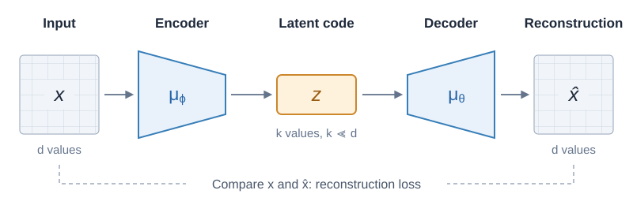

Modern flow and diffusion models work in a compressed **latent space** instead of directly in image or video space. Unlike classification, where the output can be a small set of class probabilities, the velocity or noise prediction in flow and diffusion models must have the same dimensions as the input. For video generation, those dimensions scales with the number of frames. For example, a 10-second RGB video at $1080\times720$ resolution and 25 fps contains

$$
d=10\cdot25\cdot1080\cdot720\cdot3
=583{,}200{,}000
\approx6\cdot10^8
$$

values. As you can imagine, training and inference in such a large space can be very expensive. In this post, we will discuss a "compression trick" to reduce that cost: encode the data into a smaller representation, train our generative model there, and decode the result back into pixels.

## Autoencoder

The intuition behind compression is that natural images have structure. Their pixels are related, so we may be able to preserve the important information in far fewer numbers. Geometrically, we can think of the data as lying near a lower-dimensional manifold within the full image space.

We build an **encoder** and a **decoder**:

$$
\mu_\phi:\mathbb R^d\rightarrow\mathbb R^k,
\qquad
\mu_\theta:\mathbb R^k\rightarrow\mathbb R^d,
\qquad k\ll d.
$$

The encoder maps an image $x$ to a latent code $z=\mu_\phi(x)$; the decoder reconstructs it as $\hat x=\mu_\theta(z)$. Together, they form an **autoencoder**. A smaller $k$ gives stronger compression, but may discard details needed for a good reconstruction.



*The encoder compresses the input; the decoder learns to reconstruct it from the latent code.*

We train both networks together using a reconstruction loss, such as squared error:

$$
\mathcal L_{\mathrm{AE}}(\phi,\theta)
=\mathbb E_{x\sim p_{\mathrm{data}}}
\left[\|x-\mu_\theta(\mu_\phi(x))\|^2\right].
$$

However, such an autoencoder is usually not good enough for our generative models. 

Our eventual goal is to learn the distribution of encoded data, $p_{\mathrm{latent}}$, obtained by encoding samples from $p_{\mathrm{data}}$. Reconstruction loss alone says little about how those codes are arranged. The encoder might compress images well while placing their codes in scattered regions that are difficult to model.

So we want both good reconstructions and some control over the latent distribution. A VAE gives us a way to balance these goals.

## Variational Autoencoder (VAE)

### Encoding a Distribution

A standard encoder assigns each image one code. A VAE encoder instead assigns it a **distribution over codes**. A common choice is a Gaussian:

$$
q_\phi(z\mid x)
=\mathcal N\!\left(z;\mu_\phi(x),
\operatorname{diag}(\sigma_\phi^2(x))\right).
$$

The encoder now predicts a mean and a variance for each latent coordinate. Think of each image as having a cloud of possible codes: $\mu_\phi(x)$ locates the cloud, and $\sigma_\phi(x)$ controls its spread. During training, we sample $z$ from that cloud and ask the decoder to reconstruct the same image. It therefore has to work across the sampled neighborhood, rather than only at one exact code.

The decoder also has a probabilistic interpretation:

$$
p_\theta(x\mid z)=\mathcal N\!\left(x;\mu_\theta(z),\tau^2I_d\right).
$$

Here, $\mu_\theta(z)$ is the reconstructed image. Worth mentioning, people usually keep the decoder variance $\tau^2$ fixed. This distribution assigns higher density to images closer to the reconstruction.

### Reconstruction and Regularization

For a sampled code $z$, we want the original image to be likely under the decoder. We therefore minimize the negative log-likelihood $-\log p_\theta(x\mid z)$. For our fixed-variance Gaussian, this is just scaled squared error:

$$
-\log p_\theta(x\mid z)
=\frac{\|x-\mu_\theta(z)\|^2}{2\tau^2}+C,
$$

where $C$ does not depend on the model parameters. So the probabilistic decoder brings us back to a familiar reconstruction loss.

**But how does this organize the latent space?**

Sampling codes is only part of the idea. We also choose a shared reference distribution, the **prior** $p_{\mathrm{prior}}(z)=\mathcal N(0,I_k)$, and penalize each encoding distribution for moving too far from it. Unlike $q_\phi(z\mid x)$, the prior does not depend on an input image.

We measure the difference using **KL divergence**:

$$
D_{\mathrm{KL}}(q\|p)
=\mathbb E_{z\sim q}\left[\log\frac{q(z)}{p(z)}\right].
$$

It is nonnegative and equals zero when the distributions agree. For our Gaussian encoder and standard Gaussian prior, it has a formula we can compute directly:

$$
\boxed{
D_{\mathrm{KL}}\!\left(q_\phi(z\mid x)\|p_{\mathrm{prior}}(z)\right)
=\frac12\sum_{j=1}^k
\left(\mu_j^2+\sigma_j^2-\log\sigma_j^2-1\right).
}
$$

Here, $\mu_j$ and $\sigma_j$ are the encoder's outputs for image $x$. The $\mu_j^2$ term discourages means far from zero; $\sigma_j^2-\log\sigma_j^2-1$ is minimized at variance one. Together, they discourage encoding distributions from drifting far from the prior or becoming extremely narrow.

Combining reconstruction and regularization gives the objective from the notes:

$$
\boxed{
\mathcal L_{\mathrm{VAE}}(\phi,\theta)
=\mathbb E_{x\sim p_{\mathrm{data}}}
\left[
\mathbb E_{z\sim q_\phi(\cdot\mid x)}
\left[\frac{\|x-\mu_\theta(z)\|^2}{2\tau^2}\right]
+\beta D_{\mathrm{KL}}\!\left(q_\phi(\cdot\mid x)\|p_{\mathrm{prior}}\right)
\right].
}
$$

The first term preserves information about the image; the second encourages the encoding distributions to stay near a common prior. The weight $\beta$ controls their balance.

But, **wouldn't making every encoding match the same Gaussian lose the differences between images?**

Yes, if we forced an exact match. Every image would then produce the same code distribution, leaving the decoder no information about which image to reconstruct. This is why the KL term is a penalty we balance against reconstruction. Too much weight can cause **posterior collapse**, where the codes carry little information about the input. The goal is useful regularization, not identical encodings for every image.

### Why Is It Called “Variational”?

There is a probabilistic reason for this objective. A VAE defines a generative model by drawing $z$ from the prior and then $x$ from the decoder. Its density is

$$
p_\theta(x)=\int p_\theta(x\mid z)p_{\mathrm{prior}}(z)\,dz.
$$

We would like to maximize $\log p_\theta(x)$ on training images, but the integral is generally intractable. The encoder $q_\phi(z\mid x)$ approximates the **posterior** $p_\theta(z\mid x)$: which latent codes could have produced the observed image?

This approximation gives a computable lower bound, the **evidence lower bound (ELBO)**:

$$
\log p_\theta(x)\geq
\underbrace{
\mathbb E_{z\sim q_\phi(\cdot\mid x)}[\log p_\theta(x\mid z)]
-D_{\mathrm{KL}}\!\left(q_\phi(\cdot\mid x)\|p_{\mathrm{prior}}\right)
}_{\mathrm{ELBO}(x)}.
$$

The gap between the log likelihood and the bound is the KL divergence from the encoder distribution to the true posterior, so it is nonnegative. At $\beta=1$, minimizing our loss is equivalent to maximizing this bound. Choosing another $\beta$ changes the relative weight of regularization. “Variational” refers to learning the approximate posterior. This is the connection developed in the [original VAE paper](https://arxiv.org/abs/1312.6114).

### Reparameterization Trick

We now have a loss, but its reconstruction term involves sampling from a distribution that depends on the encoder parameters. How do we let gradients backprop through that sampling step?

Instead of treating the draw as a black box, write it as

$$
\epsilon\sim\mathcal N(0,I_k),
\qquad
\boxed{z=\mu_\phi(x)+\sigma_\phi(x)\odot\epsilon.}
$$

Here, $\odot$ means elementwise multiplication. This produces exactly the same Gaussian samples. For example, a one-dimensional encoding with mean $2$ and standard deviation $0.5$ gives $z=2+0.5\epsilon$.

The randomness now comes from $\epsilon$, whose distribution does not depend on the encoder. For each drawn $\epsilon$, $z$ is a differentiable function of the predicted mean and standard deviation. Ordinary backpropagation can therefore update both the encoder and decoder. This is the **reparameterization trick**.

## PyTorch Example

The training step follows the same sequence: encode, sample a latent code, reconstruct, and combine reconstruction error with the KL penalty. The encoder predicts `logvar`, the log variance, so the variance stays positive after exponentiation.

```python
import torch

beta = 1.0  # Standard VAE weight; tune for the reconstruction tradeoff.
decoder_variance = 1.0  # Fixed tau^2 in this example.

x = sample_data(batch_size)
mu, logvar = encoder(x)
std = torch.exp(0.5 * logvar)
z = mu + std * torch.randn_like(std)
x_hat = decoder(z)

recon = (x - x_hat).square().flatten(1).sum(1) / (2 * decoder_variance)
kl = 0.5 * (mu.square() + logvar.exp() - logvar - 1)
loss = (recon + beta * kl.flatten(1).sum(1)).mean()

optimizer.zero_grad()
loss.backward()
optimizer.step()
```

The optimizer updates both networks. One sampled code per image estimates the reconstruction expectation, while the KL term is computed exactly. Here, `decoder(z)` returns the mean reconstruction $\mu_\theta(z)$.

## Generating in Latent Space

Once the autoencoder is trained, we freeze it and return to the flow or diffusion training recipe from the previous posts. We now train on codes $z\sim q_\phi(\cdot\mid x)$ with $x\sim p_{\mathrm{data}}$, instead of directly on images.

At generation time, we start from noise in latent space, run the trained flow or diffusion model, then decode its final code:

$$
\text{latent noise}
\xrightarrow{\text{flow or diffusion}}
z_{\mathrm{new}}
\xrightarrow{\mu_\theta}
x_{\mathrm{new}}.
$$

We use the decoder mean to avoid adding pixel noise. The expensive sequence of generation steps happens in the smaller space, with decoding performed once at the end.

Here is an interesting question, **if we already have a Gaussian prior, why train another generative model?**

The way I think about it: a VAE can generate by sampling directly from its prior and decoding. But the KL penalty only encourages the encoded data to resemble that prior. The actual latent distribution is a mixture of the different encoding distributions and need not be Gaussian. A latent flow or diffusion model learns this distribution more flexibly, while the autoencoder handles compression and reconstruction.

In practice, image autoencoders often use weak KL regularization and add perceptual or adversarial losses to improve reconstruction quality, as in [latent diffusion models](https://arxiv.org/abs/2112.10752). The simple objective above explains the VAE mechanism; high-quality compression can require more than pixelwise squared error.

## Summary

Working in latent space reduces the cost of generation by moving the repeated flow or diffusion steps into a smaller representation. A VAE learns that representation by balancing reconstruction with a KL penalty, and the reparameterization trick lets us train both networks through sampled latent codes.

The two models have complementary jobs: the autoencoder preserves enough information to reconstruct the data, and the flow or diffusion model learns to generate new codes. Compression makes generation cheaper, while its reconstruction quality sets a limit on what we can recover at the end.
